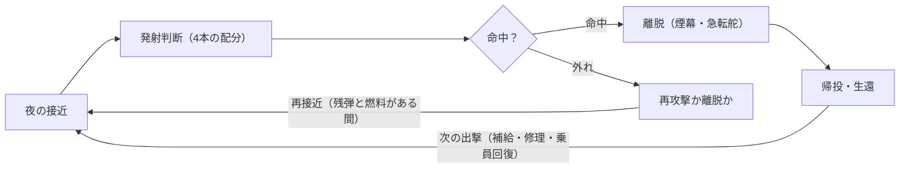

# WWII魚雷艇ゲーム 史実リサーチ＆設計資料

- 作成日: 2026-10-01（Claude Docs版をMarkdownに再構成、2026-10-02）
- 版: v0.1.0（docs）
- 用途: ゲームの数値設計・ミッション設計・バランス調整の根拠。数値は `data/*.json` に転記済み。
- 注意: 「未確認」と書いた項目は裏が取れていない。ゲームの数値に使う場合は「提案値」として扱う。

---

## 0. 結論：ゲームに効く史実5点

魚雷艇戦の史実は「魚雷は当たらず、敵以外の理由で沈む」に尽きる。ゲームの核は接近・発射判断・離脱・生還に置く。

1. **魚雷は当たらない武器だった。** 米PTはブラケット海峡（1943年8月1〜2日）で15隻・約30本を撃って命中ゼロ、スリガオ海峡（1944年10月25日）は35本で日本側確認は軽巡阿武隈への1本だけ。Sボートの戦果数値も戦果報告ベースで、ドイツの歴史海事アーカイブが原典の誤りを多数指摘している。
2. **損失の約65%は敵以外。** 米公刊史の損失69隻のうち座礁20、友軍誤射7、港内火災6、衝突事故3、暴風3。敵の直接攻撃は24隻（35%）。
3. **速度・夜間視界・燃料のトレードオフ。** Sボートはディーゼルで40kt超、航続700nm超、艇尾波が小さい。PT/MTBはガソリンで40kt、火災リスクが高く航続が短い。
4. **日本の魚雷艇はエンジン不足で20〜30ktが大半。** 米艦船への戦果は本調査では1件も確認できなかった。
5. **任務は多様。** 大発掃討、要人脱出、閘門爆破、特攻艇迎撃、工作員輸送など、ミッション素材は豊富。

---

## 1. 確定した設計判断（2026-10-01）

| 論点 | 判断 | 状況 | 理由 |
| --- | --- | --- | --- |
| 日本側キャンペーン | 弱者視点（回避・輸送・隼艇の護衛・生還が目的）のハードモードとして実装 | 確定 | 史実では速力劣勢・出撃前に空襲で喪失が多く、通常モードでは成立しない |
| 魚雷の命中率 | 「当たらない魚雷」はコンセプトに残すが、史実忠実には寄せず爽快感側に傾ける | 確定 | 史実値（数%）をそのまま使うと面白さが失われる |
| 主軸キャンペーン | 米PT（Elco 80ft）を最有力候補としてプロトタイプで検証 | 推奨（未確定） | 資料量・ミッションの多様性・数値の揃い方で最も設計しやすい |
| 技術スタック | Phaser 3 + TypeScript + Vite（PWA先行、App StoreはCapacitor） | 確定（2026-10-02） | 開発環境がWindowsのみ。iPhone Safariで即テストできる |

---

## 2. 各国の呼称と位置づけ

魚雷艇は6か国で性格が大きく違い、ゲームでは「国＝プレイスタイル」になる。

| 国 | 呼称 | 代表艇 | 主戦域 | 特徴 |
| --- | --- | --- | --- | --- |
| 米 | PT boat（Patrol Torpedo） | Elco 80ft、Higgins 78ft | ソロモン・ニューギニア・フィリピン・地中海・英仏海峡 | ガソリン、重武装化、レーダー搭載が早い |
| 独 | Schnellboot（S-Boot。英呼称E-boat） | S-38級、S-100級 | 英仏海峡・北海・地中海・黒海・バルト海 | ディーゼル、長航続、装甲艇橋、レーダー無し |
| 英 | MTB／MGB／Fairmile D | Vosper 70ft、Fairmile D「Dog Boat」 | 海峡・北海・地中海・ノルウェー沿岸 | MGB（砲艇）とMTB（雷撃艇）の役割分担 |
| 日 | 魚雷艇（乙型・甲型）、隼艇 | T-14型、T-38型、甲型T-51 | ソロモン・フィリピン・沖縄 | エンジン不足で劣速、空襲で出撃前に喪失が多い |
| 伊 | MAS／MS | MAS 500系、MS（CRDA 60t） | 地中海・紅海・黒海 | 45kt級の高速。第一次大戦で戦艦を沈めた実績 |
| ソ | トルペードヌィ・カーテル | G-5、D-3 | 黒海・バルト・北極・1945年対日 | G-5は50kt級だが後方投下式で海況に弱い |

**日本語の用語注意**：魚雷艇（20〜90t級の小型艇）と水雷艇（千鳥型・鴻型、600〜800t級の艦艇）は別物。隼艇は乙型船体から魚雷を外して機銃を増備した砲艇。雷艇は速力不足で雑役船扱いになった艇。震洋は魚雷艇の船型を元にした特攻艇（6,197隻）。

---

## 3. 艇スペック比較

速力は各国とも40kt前後で横並び。差が出るのは航続・燃料の種類・乗員数・魚雷の本数で、ここがゲームの国別パラメータになる。日本艇の型別詳細は§8の表を参照。

| 艇 | 全長 | 排水量 | 機関 | 速力 | 航続 | 乗員 | 魚雷 | 砲・機銃 | 建造数 |
| --- | --- | --- | --- | --- | --- | --- | --- | --- | --- |
| 米 Elco 80ft | 24.4m | 40〜56t | Packard 4M-2500×3（1,200→1,350→1,500hp） | 設計40kt超、実用30kt台後半 | 100オクタン3,000gal、行動半径500nm要求 | 12〜17 | 53.3cm Mk 8×4→1943年半ばからMk 13×4（ラック式） | 12.7mm連装×2、20mm、37mm、40mm、ロケット | 326（米PT全体531） |
| 米 Higgins 78ft | 23.8m | 未確認 | 同上 | 約40kt。Elcoより旋回性良 | 同上 | 同上 | 同上 | 同上 | 199 |
| 英 Vosper 73ft | 22.3m | 47t | Packard×3 4,200hp | 40kt | 470nm@20kt | 13 | 18in×4（Mk XV） | 20mm×2、6pdr | Vosper社全体で約350 |
| 英 Fairmile D | 35m | 102〜118t | Packard×4 5,000hp、燃料5,200gal | 29kt | 506nm全速／2,000nm@11kt | 21 | 18in×4 or 21in×2 | 6pdr×2、2pdr、20mm | 228 |
| 独 S-100級 | 34.9m | 100〜117t | MB 501→MB 511×3（6,000→7,500PS） | 39〜42kt（MB 518搭載艇は45kt） | 700〜750nm | 21〜24 | 53.3cm発射管2＋予備2（G7a） | 20mm、37mm/40mm、後期30mm連装×3 | Sボート全体191〜250（資料差） |
| 独 S-30級 | 32.8m | 81〜100t | MB 502×3 3,960shp | 36kt | 800nm@30kt | 21〜30 | 2＋2 | 20mm×3、37mm | 16 |
| 日 T-38型（乙型） | 18.0m | 約20t | 金星41型×2 1,400hp | 27.5kt | 220nm@26kt | 7 | 45cm×2（舷側落射） | 25mm×1 | 74〜80 |
| 伊 MAS 500系 | 18m級 | 未確認 | Isotta Fraschini ASM 184 1,500hp | 最大45kt | 未確認 | 未確認 | 45cm×2 | 13.2mm×1 | 1940年時点48隻 |
| ソ G-5 | 18.85m | 14〜16t | GAM-34 675〜1,000hp×2 | 45〜56kt | 未確認 | 6〜7 | 53.3cm×2（艇尾の溝から後方投下） | 7.62→12.7mm | 約300 |
| ソ D-3 | 22.4m | 31t | GAM-34BS×3（後期Packard） | 32kt→1943型47kt | 未確認 | 未確認 | 53.3cm×2（側方投下） | 12.7mm×2 | 73 |

PTの燃料消費は23kt巡航で約200gal/h、全速で約500gal/h（巡航15時間・全速6時間に相当）。エンジン換装は600時間ごと。Elco 70ftは2.4〜3mの波で船底フレーム破損・外板亀裂が出た試験記録があり、海況制限の根拠になる。

出典: Bulkley Part II (https://www.ibiblio.org/hyperwar/USN/CloseQuarters/PT-2.html)、PT boat (https://en.wikipedia.org/wiki/PT_boat)、Fairmile D (https://en.wikipedia.org/wiki/Fairmile_D_motor_torpedo_boat)、E-boat (https://en.wikipedia.org/wiki/E-boat)、german-navy.de (https://www.german-navy.de/kriegsmarine/ships/fastattack/index.html)、navypedia T-38 (https://www.navypedia.org/ships/japan/jap_aux_t38.htm)、G-5級 (https://en.wikipedia.org/wiki/G-5-class_motor_torpedo_boat)、D3級 (https://en.wikipedia.org/wiki/D3-class_motor_torpedo_boat)

---

## 4. 魚雷の性能と航走時間

魚雷は1,500mを走るのに1〜2分かかり、ただし史実の実効発射距離は400〜1,000ydだった。駆逐艦が30ktで回避すると60秒で約930m動くので、扇状発射と見越し角がゲームの核心になる。

| 魚雷 | 弾頭 | 速力／射程 | 備考 |
| --- | --- | --- | --- |
| 米 Mk 8 Mod 3C/3D（PT初期） | 385〜466lb TNT（Mod差） | 27kt／13,500yd（navweapsとBulkleyが一致。Wikipediaの36kt／16,000ydは不一致） | 1911年設計。黒色火薬射出の不発→管内ホットラン、発射閃光とグリスの黒煙で位置露呈、最小深度約3mで大発の下を抜ける |
| 米 Mk 13（PT後期） | 600lb Torpex | 33.5kt／6,300yd（4,000yd説あり） | 航空魚雷の転用。ラックから静かに転落、軽量化分を砲に回した |
| 独 G7a（T1） | 280kg | 44kt／6,000m、40kt／8,000m、30kt／14,000m | 雷跡（気泡）が見える |
| 独 G7e（T3） | 280kg | 30kt／5,000〜7,500m | 無航跡・静音。予熱が必要。Sボート搭載を確認 |
| 英 18in Mk XV | 247kg Torpex | 40kt／2,500yd、33kt／3,500yd | MTB搭載は1943年〜 |
| 英 21in Mk VIII** | 365kg Torpex | 40〜45.5kt／5,000yd | Fairmile D等 |
| 日 45cm 四四式（後期） | 208kg | 35kt／3,000m、26kt／7,000m | 魚雷艇の搭載型式は未確認（四四式か二式か） |
| 伊 W 200／Si 170 | 200kg／170kg | 44kt／3,000m／41kt／4,000m | MAS搭載。MS艇は533mm管に縮径ケージで450mmを使用 |
| ソ 53-38 | 300kg | 44.5kt／3,900m、30.5kt／10,000m | G-5主用 |

航走時間の目安（1,000yd／1,500m／2,000m）: 27kt＝66／108／144秒、33.5kt＝53／87／116秒、40kt＝44／73／97秒、44kt＝40／66／88秒。Channel Dash（1942年2月12日）の4,000ydは「極限距離」で全弾外れた。

出典: navweaps 米魚雷 (http://www.navweaps.com/Weapons/WTUS_PreWWII.php)、独魚雷 (https://www.navweaps.com/Weapons/WTGER_WWII.php)、英魚雷 (https://www.navweaps.com/Weapons/WTBR_WWII.php)、ソ連魚雷 (http://www.navweaps.com/Weapons/WTRussian_WWII.php)、regiamarina.net (https://regiamarina.net/torpedoes/)、Japanese 45 cm torpedo (https://en.wikipedia.org/wiki/Japanese_45_cm_torpedo)、Mark 8 torpedo (https://en.wikipedia.org/wiki/Mark_8_torpedo)、Mark 13 torpedo (https://en.wikipedia.org/wiki/Mark_13_torpedo)

---

## 5. 運用・戦術の実像

各国共通で夜間出撃・昼間整備。戦術の違いは「何を狙ったか」であり、ミッションの色分けにそのまま使える。

**昼夜のサイクル**：PTの1出撃は薄暮〜翌朝のおよそ10〜12時間、2〜4隻単位。昼は陸上設備不足のため整備に当てた。Sボートは昼間はIJmuidenやBoulogneのブンカーで待避した。

**米PT**：低速で接近し、小さな煙幕を置きながら90度変針を繰り返して離脱。典型的な魚雷発射距離は400〜1,000yd。2,000ydでの試みは成果が乏しかった。1943年3月のビスマルク海海戦後は日本軍が大発輸送に依存したため「空軍が昼、PTが夜」の大発掃討に転換し、岸から200〜400ydを這って月間44〜55隻（1943年7〜12月）を撃破した。PBY「Black Cat」との夜間協同、SOレーダー（約17nm、1943年にほぼ全艇装備）が強み。日本軍水上機による夜間のPT狩りが常態化し、スクリューの夜光虫航跡が発見の手がかりになった。

**独Sボート**：初期は船団航路上で待ち伏せ（Lauertaktik）だが航空偵察がなく空振りが多く、1942年半ばから偵察情報に基づく突入（Stichansatz）へ。英東岸の船団航路襲撃と機雷敷設が主任務。レーダーは実戦配備されず（FuMO 71/72の試験艇は「先に見つかる」と酷評）、連合軍のレーダー・航空優勢で1943年以降の戦果が低下。補助舵を外振りする「リュールセン効果」で艇尾波を抑え、夜間に見えにくかった。

**英Coastal Forces**：MGBが予期しない方向から砲撃して護衛の注意を引き、その間にMTBが雷撃点へ機動する分業。1944年時点で士官3,000・兵22,000、艇約2,000。基地はFelixstowe、Dover、Lowestoft、Gosport（HMS Hornet）など。

**日本**：1942年秋以降、米PTのソロモン輸送妨害への対抗策として投入要求が出たが、木造合板船体が脆弱で出撃前に空襲で破壊される例が多く活躍は限定的。1943年の「2年で1,500隻」計画はエンジン不足で実績約500隻。

出典: Bulkley Part III (https://www.ibiblio.org/hyperwar/USN/CloseQuarters/PT-3.html)、Part IV (https://www.ibiblio.org/hyperwar/USN/CloseQuarters/PT-4.html)、schnellbootnet 戦域 (https://schnellbootnet.jimdofree.com/kriegsmarine-kriegsschaupl%C3%A4tze-i/)、navweaps 独レーダー (https://www.navweaps.com/Weapons/WRGER_09.htm)、Motor Gun Boat (https://en.wikipedia.org/wiki/Motor_Gun_Boat)、魚雷艇（大日本帝国海軍） (https://ja.wikipedia.org/wiki/魚雷艇_(大日本帝国海軍))

---

## 6. 主要海戦年表（ミッション素材）

1937年の上海から1945年のサマール焼却まで、ミッションになりうる戦闘を時系列で並べた。太字は魚雷艇が戦局を動かした例。

| 年月日 | 戦闘 | 概要 |
| --- | --- | --- |
| 1937年8月 | 上海 | 中国海軍のソーニクロフトCMBが第三艦隊旗艦「出雲」を雷撃（失敗）。日本の魚雷艇開発の転機 |
| 1940/5/23〜31 | ダンケルク | S-21/23が仏駆逐艦Jaguar雷撃、**S-30が英駆逐艦Wakeful撃沈**（兵640名中生存4名）、S-23/26が仏Siroco撃沈。英MTB 102はWake-Walker少将の旗艦に |
| 1941/4/8 | 紅海 | 伊MAS 213が英軽巡Capetownを雷撃損傷 |
| 1941/12〜42/4 | フィリピン | MTB Sqn 3（Bulkeley、6隻）。**1942/3/11〜13 PT-41がマッカーサーをコレヒドール→ミンダナオへ約560マイル脱出**。初期の「巡洋艦撃沈」報告は後に海軍自身が虚偽と認識 |
| 1942/2/12 | チャンネル・ダッシュ | ドーバーのMTB 5隻がSボート12隻×2列に阻まれ、命中なし |
| 1942/3/27〜28 | サン・ナゼール | MTB 74が遅延信管魚雷で閘門を雷撃。ML 16隻中12隻喪失、MGB 314の砲手SavageにVC |
| 1942/6/14〜15 | 地中海 | S-55が英駆逐艦Hasty撃沈、S-56（Wuppermann）が巡洋艦Newcastle雷撃 |
| 1942/8/13 | ペデスタル作戦 | **伊MS 16・MS 22が英軽巡Manchester（11,350t）を雷撃→自沈**。魚雷艇に沈められた最大の軍艦。MAS/MSが商船4隻も撃沈 |
| 1942/12/11〜12 | ガダルカナル | **PT-37・40（諸説）が駆逐艦照月に命中、爆沈**。PT-44喪失。照月の残骸は2025年7月にE/V Nautilusが発見 |
| 1943/2/1 | ケ号作戦 | PT 11隻が迎撃、PT-37・111・123喪失。巻雲はPT回避中に触雷沈没 |
| 1943/3/12 | チュニジア沖 | S-55（Horst Weber）が英駆逐艦Lightning撃沈 |
| 1943/4/12〜13 | ベルギー〜オランダ沿岸 | MGBのエースRobert Hichens戦死 |
| 1943/8/1〜2 | ブラケット海峡 | PT 15隻・約30本で命中ゼロ。**天霧がPT-109を切断**、ケネディら11名が泳いで島へ。Biuku Gasa・Eroni Kumanaのココナツ伝言で8/8救助 |
| 1943/10/24〜25 | クローマー沖 | 英駆逐艦WorcesterとMTB群がS-63・S-88を撃沈 |
| 1944/4/28 | Exercise Tiger（Lyme Bay） | **第5・第9 S戦隊9隻がLST-507・531を撃沈**、米軍死者749（639／946説あり） |
| 1944/6/6 | ノルマンディー | 第9 S戦隊がシェルブールから出撃し最大射程で発射して帰投。ノルウェー駆逐艦Svennerを沈めたのはSボートではなく第5水雷艇戦隊 |
| 1944/6/14 | ル・アーヴル空襲 | Sボート多数喪失（隻数は本調査で未確認） |
| 1944/8/8〜9 | ジャージー島沖 | PT-509が独掃海艇に衝突・爆発、生存1名 |
| 1944/10/10 | 沖縄・運天港 | 第27魚雷艇隊が空襲で18隻中13隻喪失 |
| 1944/10/24〜25 | スリガオ海峡 | **PT 39隻・13セクション**が初接触、35本発射で確認命中は阿武隈への1本（PT-137）。30隻が被弾圏、PT-493喪失 |
| 1944/12/11〜12 | オルモック湾 | **PT-490・492が駆逐艦卯月を撃沈**（日本側記録一致）。特攻でPT-323・300喪失 |
| 1945/1/10 | リンガエン湾 | 震洋がLCI(M)-974撃沈、4隻損傷（魚雷艇とは別枠） |
| 1945/2/14 | オステンド | 港内火災でカナダ29th MTB Flotilla 5隻・26名、英Fairmile D 4隻喪失 |
| 1945年11月 | サマール島Bobon Point | 米PT 118〜121隻を装備撤去のうえ焼却処分 |

出典: Bulkley Part I (https://www.ibiblio.org/hyperwar/USN/CloseQuarters/PT-1.html)、Part VIII (https://www.ibiblio.org/hyperwar/USN/CloseQuarters/PT-8.html)、PT-109 (https://en.wikipedia.org/wiki/Motor_Torpedo_Boat_PT-109)、Battle of Surigao Strait (https://en.wikipedia.org/wiki/Battle_of_Surigao_Strait)、Battle of Ormoc Bay (https://en.wikipedia.org/wiki/Battle_of_Ormoc_Bay)、照月 (https://en.wikipedia.org/wiki/Japanese_destroyer_Teruzuki_(1941))、NHHC 照月発見 (https://www.history.navy.mil/news-and-events/news/2025/Flagship-Imperial-Japanese-Naval-Destroyer-Teruzuki-Found.html)、HMS Wakeful (https://en.wikipedia.org/wiki/HMS_Wakeful_(H88))、HMS Lightning (https://en.wikipedia.org/wiki/HMS_Lightning_(G55))、HMS Manchester (https://en.wikipedia.org/wiki/HMS_Manchester_(15))、Exercise Tiger (https://en.wikipedia.org/wiki/Exercise_Tiger)、HNoMS Svenner (https://en.wikipedia.org/wiki/HNoMS_Svenner_(G03))、St Nazaire Raid (https://en.wikipedia.org/wiki/St_Nazaire_Raid)、Channel Dash (https://en.wikipedia.org/wiki/Channel_Dash)、29th MTB Flotilla (https://en.wikipedia.org/wiki/29th_Motor_Torpedo_Boat_Flotilla)、総務省 沖縄戦災（運天港） (https://www.soumu.go.jp/main_sosiki/daijinkanbou/sensai/situation/state/okinawa_34.html)、USN Chronology 1945 (https://www.ibiblio.org/hyperwar/USN/USN-Chron/USN-Chron-1945.html)

---

## 7. 戦績と損失の実像（バランス調整の根拠）

どの国も「戦果は報告値より小さく、損失は敵以外が多い」。ゲームのイベント発生重みは次の表の比率をそのまま使える（`data/risk_events.json` に転記済み）。

### 7.1 米PT損失69隻の原因別内訳（Bulkley『At Close Quarters』付録Bを本調査で集計）

| 原因 | 隻数 | 敵の直接攻撃か | 主な艇 |
| --- | ---: | --- | --- |
| 座礁（敵地での処分18を含む） | 20 | いいえ | 31,33,68,73,118,135,136,145,147,153,158,172,193,321,322,339,368,371／113,338 |
| 敵艦の砲撃・衝突 | 8 | はい | 37,43,44,111,112,493／109（被衝突）／509 |
| 敵航空機（特攻2を含む） | 7 | はい | 34,117,123,164,320／300,323 |
| 友軍誤射 | 7 | いいえ | 77,79（米艦）、121,353（豪機）、166,346,347（米機） |
| 港内火災・爆発 | 6 | いいえ | 63,107（Emirau）、67,119（Tufi）、239（Vella Lavella）、301（Mios Woendi） |
| 敵沿岸砲 | 5 | はい | 133,247,251,337,363 |
| 機雷 | 4 | はい | 202,218,311,555 |
| 衝突事故 | 3 | いいえ | 110,200,279 |
| 暴風 | 3 | いいえ | 22,28,219（アリューシャン） |
| 鹵獲防止の処分 | 3 | いいえ | 32,35,41 |
| 輸送中（タンカー被雷） | 2 | いいえ | 165,173 |
| 不明（敵砲か誤射か） | 1 | いいえ | 283 |
| **合計** | **69** | 敵の直接攻撃 24隻（35%） | |

座礁は敵地で艇を処分した18隻を含む。ゲームでは「航法ミス＝艇の喪失」が最大リスクになる。

### 7.2 各国の戦績サマリ

| 項目 | 数値 | 注意 |
| --- | --- | --- |
| 米PT 損失総数 | 69隻（Bulkley付録B集計）／99隻（Wikipedia） | 算入基準の差。公刊史の69を正とする |
| 米PTの確認戦果 | 駆逐艦照月（1942/12）、駆逐艦卯月（1944/12）、軽巡阿武隈に命中（撃沈は航空）、潜水艦伊3（1942/12/9、日本側照合未）、第105号哨戒艇（共同） | 実効は「PTの存在そのものがガ島への護衛付き補給を妨害した」こと |
| Sボート戦果（報告値） | 商船101隻214,728t、駆逐艦12、掃海艇11、揚陸艦8、MTB 6、潜水艦1。機雷で商船37隻148,535t | 歴史海事アーカイブが原典の誤りを多数指摘。Manchester撃沈をSボートとする記述は誤り |
| Sボート損失 | 約146隻。空襲≒45、機雷≒28、水上戦≒22、自沈≒18、事故≒12 | 要員7,500名中、戦死767・負傷620・捕虜322 |
| 英Coastal Forces | 約2,000隻、損失170隻、撃沈約400隻（うちSボート48）、魚雷1,169本発射、戦闘900回超 | Wikipedia単独ソース、要照合 |
| 日本魚雷艇 | 完成約500隻（隼艇含む）、未成含め約800隻 | 米艦船への戦果は公刊史・NHHCで1件も確認できず。震洋（6,197隻）はLCI(M)-974、PC-1129、LCS(L)-7、LSM-12、LCI(G)-82等を撃沈 |
| ソ連G-5 | 約300隻、1941/6/22保有254隻、戦没73 | バルト海での確認撃沈は2隻のみ（ソ連側請求との乖離） |

出典: Bulkley 付録B (https://www.ibiblio.org/hyperwar/USN/CloseQuarters/PT-B.html)、PT boat (https://en.wikipedia.org/wiki/PT_boat)、ww2db S-boat (https://ww2db.com/ship_spec.php?ship_id=n876)、schnellbootnet 損失 (https://schnellbootnet.jimdofree.com/kriegsmarine-verluste-verbleib/)、歴史海事アーカイブ (https://www.historisches-marinearchiv.de/projekte/s_boote/beschreibung.php)、Coastal Forces of the Royal Navy (https://en.wikipedia.org/wiki/Coastal_Forces_of_the_Royal_Navy)、乙型魚雷艇 (https://ja.wikipedia.org/wiki/乙型魚雷艇)、combinedfleet 沖縄震洋 (http://www.combinedfleet.com/OkinawaEMB.htm)

---

## 8. 日本海軍魚雷艇の深掘り

日本の魚雷艇は船体ではなくエンジンで負けた。設計50ktの購入MAS艇をコピーできず、中古航空機エンジンの寄せ集めで速力17〜39ktをばらつかせた。

**開発史**：1922年に研究開始。転機は1937年の「出雲」被雷撃と1938年広東で鹵獲した中国のCMB-55型（38kt）。1940年8月にイタリアMAS艇を50万円で購入（設計50kt、試験48.5ktで日本海軍艦船中最速）し、エンジンを三菱で「71号6型」としてコピーしたが実用化は1943年2月、月産3〜4台から最大20台程度。T-0試作艇→T-1（第一号型、1941年、6隻）は20t級の乙型であり、甲型ではない。甲型は32m・80t級のT-51（10号・11号型）で完成8隻。

**構造的問題**：軽量高出力ディーゼルがなく、九一式・九四式・金星41・火星11・寿3・明星2・震天21・RR・イスパノなど中古航空機エンジンの寄せ集め。空冷航空エンジン型は出力の20%を冷却ファンに消費。世界トップ級の2ストディーゼルは実戦に間に合わず。甲型は資材節約の鉄骨木皮で計画80tが90t超、振動で速力低下、凌波性不足。

| 型 | 船体・寸法 | 機関 | 速力 | 兵装・乗員 | 建造数 |
| --- | --- | --- | --- | --- | --- |
| T-1（第一号型、乙型） | 17t、18.3×4.30m | 九四式×2 1,800hp | 38.5kt（navypedia）／35kt（別資料） | 45cm×2、7.7mm×2、7名 | 6 |
| T-14（538号型） | 木製14.5t、15.0×3.65m | 71号6型×1 920hp | 30〜33kt | 45cm×2、13mm or 25mm×1、7名 | 83（ja）／32完成＋5未成（navypedia） |
| T-15 | 木製15t、15.2×3.80m | 71号6型×1 920hp | 35kt | 同上 | 40（navypedia）／2（ja） |
| T-25（469号型） | 木製20t級、18m | 71号6型×1 920hp | 26kt | 45cm×2 | 55 |
| T-35（468号型） | 木製20t級、18m | 71号6型×2 1,840hp | 38kt | 45cm×2 | 10（navypediaは型番・機関が食い違う） |
| T-38（241号型） | 木製20t級、18m | 金星41型×2 1,400hp | 27.5kt（26ktで220nm） | 45cm×2、25mm×1 | 74〜80 |
| T-23／T-33（鋼製低速型） | 鋼製 | 九一式×1〜2 500〜1,200hp | 17〜21kt | 大半が雷艇化 | 25／39 |
| 甲型 T-51（10・11号型） | 鉄骨木皮、32.4×5.0m、75〜90t | 71号6型×4 3,600hp | 計画30、実際24〜29kt | 45cm×2（10号は4）、25mm×2〜3、18名 | 8（計画18） |
| H-2 隼艇 | 鋼製24.7t | 火星11型×2 2,100hp | 33.5kt | 20mm×2、7.7mm×2、8名 | 8 |
| H-38 隼艇 | 木製24.8t、18.0×4.30m | 金星×2 1,400hp | 27kt | 25mm×3、爆雷4 | 50（ja）／約24（navypedia）／約40（navypedia の番号の幅から。推論・low。v0.6.6） |
| 震洋 一型／五型 | 5.1m 1.3t／6.5m 2.2t | トヨタ製トラック用B型改 | 20〜30kt | 炸薬250〜270kg | 6,197 |

**部隊と実戦**：魚雷艇隊は第1・2・3・11・12・21・22・23・25・26・27・31隊などが確認できる。T-1（第一号型・6隻）は開戦時にタラワとウェークへ半分ずつ配備されたと伝わる（ゲームの wiki の抜粋だけ・low）。navypedia の喪失日は第2・3号 1943-09-19、第4号 1944-03-24、第5・6号 1944-01-30 で、第1号は終戦後まで残った（場所と原因は抜粋に無い・medium）。以前ここに書いた「大半が1943年に戦没（1944/1/30ウェークで第5・6号艇がPB2Yに撃沈）」は v0.6.7 の調査で確かめられなかった（3 つの別々の抜粋をつないだ推論・low。下の「ウェーク島と米の哨戒機」）。鹵獲した蘭 TM-4 型（日本の第102〜120号。navypedia は第101号（旧 TM 3）を別の型とし、武装されず出撃もほぼ無かったとする。ja.wikipedia は TM-4 型の艇を第百一号型と呼ぶ）はラバウル・ラエ方面で使われた（v0.6.3 で「101号型」を訂正。下の「米PT とラバウル・鹵獲 TM 艇」）。沖縄の第27魚雷艇隊（運天港、白石信治大尉）は1944/10/10の空襲で13隻喪失し、慶良間上陸後に米艦艇攻撃を試みたが戦闘能力を失い1945/9/3投降。Bulkley第VIII部、NHHC、多号作戦記録のいずれにも日本魚雷艇との交戦記述がなく、対米戦果は確認できなかった。

**日本語文献**：今村好信『日本海軍魚雷艇全史』（光人社NF文庫、建造史＋比島戦記＋米PT、https://www.kinokuniya.co.jp/f/dsg-01-9784769833550 ）、同『日本魚雷艇物語』（2003）、正岡勝直「日本海軍魚雷艇の回顧」『世界の艦船』1967年11月号、島尾敏雄『魚雷艇学生』。

出典: 魚雷艇（大日本帝国海軍） (https://ja.wikipedia.org/wiki/魚雷艇_(大日本帝国海軍))、乙型魚雷艇 (https://ja.wikipedia.org/wiki/乙型魚雷艇)、甲型魚雷艇 (https://ja.wikipedia.org/wiki/甲型魚雷艇)、第一号型魚雷艇 (https://ja.wikipedia.org/wiki/第一号型魚雷艇)、隼艇 (https://ja.wikipedia.org/wiki/隼艇)、MAS艇（日本海軍） (https://ja.wikipedia.org/wiki/MAS艇_(日本海軍))、震洋 (https://ja.wikipedia.org/wiki/震洋)、navypedia 日本小型艇一覧 (https://www.navypedia.org/ships/japan/jap_boats.htm)、USN Chronology 1944 (https://www.ibiblio.org/hyperwar/USN/USN-Chron/USN-Chron-1944.html)

**米PT とラバウル・鹵獲 TM 艇（v0.6.3 の追加調査、2026-10-20。jp_05 の史実アンカーの根拠）**

この節の事実はすべて WebSearch の結果の要約・抜粋から取った。WebFetch はどのホストにも届かず（クラウドのネットワークは npm と GitHub だけ）、ページの本文は 1 つも読めていない。各行に「WebSearch の抜粋のみ・本文未読」と確度を付ける（high＝独立の 2 つ以上か公刊史・公的な出典が一致、medium＝出典が 1 つか細部が食い違う、low＝個人・ゲームの資料だけか推論）。§14（実際に開いたページ）には入れない。調査の全文は v0.6.3 の作業メモ（英語資料・日本語資料の 2 本）。Bulkley III＝https://www.ibiblio.org/hyperwar/USN/CloseQuarters/PT-3.html （ソロモン）、Bulkley IV＝https://www.ibiblio.org/hyperwar/USN/CloseQuarters/PT-4.html （ニューギニア・ニューブリテン）、UNO 論文＝https://scholarworks.uno.edu/cgi/viewcontent.cgi?article=2612&context=td 。

米PT がラバウルに近づいた順（1943-06 のラバウル近海に米PT はいない）:

| 日付 | 事実 | 出典（すべて WebSearch の抜粋のみ・本文未読） | 確度 |
| --- | --- | --- | --- |
| 1943-04-20 | モロベの前進基地（PT-142・66・149 が到着）。フオン湾をラエ・サラモア・フィンシュハーフェン方面へ哨戒 | Bulkley IV ／ https://pacificwrecks.com/ship/ptboat/bases/morobe/index.html | high |
| 1943-06-30 | レンドバ（第9戦隊の 12 隻が上陸に同行し仮の基地） | Bulkley III ／ https://pacificwrecks.com/ship/ptboat/bases/bau/index.html | high |
| （推論） | 1943-06-01 のラバウル近海に米PT はいない（最寄りの基地でも数百 km。PT がラバウルの近くに出るのは 1944-02 以降） | 上の 2 行からの推論 | high（推論） |
| 1943-11-25 | ドレーガー港（フィンシュハーフェン）に第21・12戦隊、哨戒は 11-30 頃から | Bulkley IV | high（英語の調査）。日本語の調査では開設が 1943 年か 1944-06 かで食い違う（low） |
| 1943-12-15 | アラウェ（ニューブリテン南岸）上陸。基地は作らず燃料艀だけで、PT がこの海域を毎夜哨戒し始める | Bulkley IV ／ https://en.wikipedia.org/wiki/Battle_of_Arawe | high |
| 1944-02-16 | グリーン島に第10戦隊が進出 | Bulkley III ／ https://www.historyofwar.org/articles/battles_green_islands.html | high |
| 1944-02-20 | ラバウルの海軍機に夜明けの引き揚げ命令、25 日までに完了（それまでは零戦が残り昼の空襲を迎え撃った） | https://pacificwrecks.com/history/rabaul/index.html ／ https://nzetc.victoria.ac.nz/tm/scholarly/tei-WH2AirF-c16-1.html | high |
| 1944-02-29〜03-01 | PT 12 隻がラバウルへ向けて出撃（この調査で見つかったラバウル沖への出撃ではいちばん早い。それより前が無かったとまでは言えない。1 隻がラバウル港に入り、ガゼル半島とデューク・オブ・ヨーク諸島の間で大発に会う） | Bulkley III ／ https://www.historyofwar.org/articles/battles_green_islands.html | high |
| 1944-03-26 | タラセア（第8・25戦隊、母艦 Hilo）。ニューブリテン北岸をラバウルから約 40 マイルのケープ・ランバートまで哨戒 | Bulkley IV ／ https://pacificwrecks.com/location/png_talasea.html | high |

交戦の記録:

| 事実 | 出典（すべて WebSearch の抜粋のみ・本文未読） | 確度 |
| --- | --- | --- |
| 1943〜44 年のソロモン・ニューギニア・ニューブリテンで、米PT と日本の魚雷艇の交戦の記録は、英語（Bulkley・USN Chronology 1943／1944・NHHC の PT 喪失一覧・Wikipedia の沈没船一覧）でも日本語でも見つからない。この海域の米PT の損失は空襲・陸の砲・座礁・友軍・日本の軍艦。大発以外の小型の相手（潜水艦・ラガー・スクーナー・小型の補助船）とは戦っている。哨戒艇を沈めた例は後の 1944-11-28 オルモック湾の第105号哨戒艇（medium） | https://www.history.navy.mil/research/library/online-reading-room/title-list-alphabetically/u/u-s-navy-motor-torpedo-boat-operational-losses.html ／ https://www.ibiblio.org/hyperwar/USN/USN-Chron/USN-Chron-1943.html ／ https://forum.axishistory.com/viewtopic.php?t=68979 （日本の魚雷艇の戦闘はほとんど公刊されていない、low）／ 小型の相手: Bulkley IV ／ https://en.wikipedia.org/wiki/Kelanoa_Harbour （潜水艦 I-181）／ https://en.wikipedia.org/wiki/Patrol_torpedo_boat_PT-337 （ラガー）／ https://en.wikipedia.org/wiki/Patrol_torpedo_boat_PT-121 （スクーナー）／ https://en.wikipedia.org/wiki/Japanese_patrol_boat_No._105 | medium（無いことの証拠） |
| 旧 TM の第112・113号はラエで 1943-08-02 に B-25・P-38 の昼の空襲を受けた（PT ではない。第113号は沈没か大破かで食い違う） | https://www.ibiblio.org/hyperwar/USN/USN-Chron/USN-Chron-1943.html ／ https://en.wikipedia.org/wiki/List_of_shipwrecks_in_August_1943 ／ https://www.netherlandsnavy.nl/TM4class.htm | high（空襲）／medium（第113号の末路） |

米PT の小型艇に対する戦い方（jp_05 の米PT の AI の根拠）:

| 事実 | 出典（すべて WebSearch の抜粋のみ・本文未読） | 確度 |
| --- | --- | --- |
| 2 隻の分隊で哨戒した（ときに 3 隻、大きな攻撃はもっと）。例: PT-193 と PT-132（1943-10）、PT-191 と PT-152（1943-12）、PT-323 と PT-369 | Bulkley IV ／ https://pacificwrecks.com/ship/ptboat/PT-191.html | high |
| 哨戒は 1 軸のアイドル 約 6 kt で航跡をほぼ出さない（PT-109、1943-08-01〜02。夜光虫の航跡を水上機から隠す）。「8〜9 kt のアイドル」でも音は大きかった | https://www.history.navy.mil/research/histories/ship-histories/danfs/p/pt-109.html ／ https://en.wikipedia.org/wiki/Blackett_Strait ／ UNO 論文 | high（1 軸のアイドル）／medium（6 kt・8〜9 kt） |
| 寄るときは 15〜20 kt（PT-132「大発が逃げる・浜に着く前に 15 kt に上げて」、別の艇「20 kt で確かめに」）。「最初の分隊はマフラーを閉じたアイドルで 600 yd まで寄った」（ソロモン）、装甲の大発を沈めるには 100 yd よりずっと内まで寄る必要があった | UNO 論文 ／ Bulkley III | medium |
| 1943-07 から主な目標は大発。大発の吃水（約 5 ft）は魚雷の最小深度（約 10 ft）より浅く魚雷が下を抜けるので、魚雷ではなく砲で戦った | UNO 論文 ／ https://en.wikipedia.org/wiki/PT_boat ／ https://www.beyondships.com/History-PTBoats.html | high |
| 2 回目の攻撃の航過の記録がある（PT-323 と PT-369、1943-12-18〜19、フオン半島。PT-369 は 2 回目の航過で座礁）。日本側でも「同じ魚雷艇に 2 度襲われた」（恒広大隊）・「3 隻の魚雷艇から集中砲火」（片桐中将、1944-04-28） | https://pacificwrecks.com/ship/ptboat/PT-323.html ／ https://www.nids.mod.go.jp/publication/commentary/pdf/commentary247.pdf ／ https://www.nids.mod.go.jp/military_archives/siryo/siryo_39.html | medium（PT-323）／medium（恒広大隊）／high（片桐中将） |
| 「N 回の航過で去る」規則は見つからない（弾・燃料・損傷・陸の砲・哨戒の予定で決まった） | — | low（推論） |
| 発見はほぼ目。暗い雨の夜に「隊列の真ん中に入るまで大発に気づかなかった」 | Bulkley IV | medium |
| 砲は .50 連装 × 2 と 20mm。1943 年半ばから現地で 37mm（PT-103 は 1943-08-01 に乗員が追加）・40mm を足した | https://navweaps.com/Weapons/WNUS_50cal-M2_MG.php ／ https://www.history.navy.mil/research/histories/ship-histories/u-s-navy-pt-boats.html ／ https://www.navsource.net/archives/12/05103.htm | high（.50・37mm）／medium（40mm の時期） |
| SO レーダーは 1943-02 に最初の量産型を試験、1943 年から一部の艇に。小さな木造艇への探知距離は不明 | https://www.usni.org/magazines/proceedings/1967/september/shipborne-radar ／ http://ptboatworld.com/PT_Boat_Info/Radar.htm | medium（時期）／low（距離） |

T-14 と鹵獲 TM 艇:

| 事実 | 出典（すべて WebSearch の抜粋のみ・本文未読） | 確度 |
| --- | --- | --- |
| T-14（乙型の最終量産型）: ja.wikipedia の要目は 14.5 t・15.00 × 3.00 m（navypedia の抜粋は幅 3.65 m）・吃水 0.621 m・71号6型 920 馬力 1 基・33.3 kt・28 kt で 240 浬・乗員 6・13mm × 1（25mm とする資料もある）・45cm × 2。data は最大 31 kt（整備の悪い艇の design）・乗員 7 のまま | https://ja.wikipedia.org/wiki/乙型魚雷艇 ／ https://www.navypedia.org/ships/japan/jap_aux_t14.htm | medium |
| T-14 の就役は 1944〜45 年。ラバウル・ソロモン・ニューギニアにいた記録は無い（ラバウルは 1944 年初めから孤立） | https://www.navypedia.org/ships/japan/jap_aux_t14.htm ／ https://ja.wikipedia.org/wiki/乙型魚雷艇 | medium（推論を含む） |
| ラバウル方面の日本の魚雷艇は鹵獲した蘭 TM-4 型（日本の第102〜120号。navypedia は第101号（旧 TM 3）を別の型とし、武装されず出撃もほぼ無かったとする。ja.wikipedia は TM-4 型の艇を第百一号型と呼ぶ）。スラバヤで自沈した蘭の TM-4〜15 などを引き揚げ、1942〜44 年に整備した | https://www.netherlandsnavy.nl/TM4class.htm ／ http://www.navypedia.org/ships/japan/jap_aux_no102.htm ／ https://navypedia.org/ships/japan/jap_aux_no101.htm ／ https://ja.wikipedia.org/wiki/第百一号型魚雷艇 | high（TM-4 型＝第102号の型）／medium（第101号） |
| TM-4 型の要目: 19.2 × 4.3 × 1.4 m・17.5 t・36 kt（蘭の資料は「1944 年から 20 kt」。navypedia では 20 kt は第119・120号（旧 TM 20・21、1944 年就役）の値で、第102号（旧 TM 4）は 33.25 kt（medium。訂正の候補。v0.6.5 の調査。下の「機関の不調」））。ja.wikipedia は 18.60 m・17 t・日本で整備した後 30 kt・45cm 落射機 2・7.7mm 1・爆雷 4 | https://www.netherlandsnavy.nl/TM4class.htm ／ https://ja.wikipedia.org/wiki/第百一号型魚雷艇 | medium |
| 第115号（旧 TM 16）は 1943-07-26 ラバウルでガソリン爆発、第116号（旧 TM 17）は 1944 年ラバウルで、第117号（旧 TM 18）は 1944 年ラバウル沖で沈没（原因は書かれていない）。PT に沈められた艇は無い | https://www.netherlandsnavy.nl/TM4class.htm ／ https://en.wikipedia.org/wiki/List_of_shipwrecks_in_1944 | medium |

ゲームでの使い方（v0.6.3）: jp_05 は米PT のグリーン島進出（02-16）とラバウルの海軍機の引き揚げ命令（02-20）の間の 1944-02-18 ラバウル沖にし、遭遇そのものはゲーム上の想定と Briefing に書いた（元の 1943-06-01 ラバウルは米PT がまだ来ていない）。2 隻の分隊・再攻撃・砲で掃射・魚雷は下を抜ける、は史実寄り。航過の速さ（25 kt 以上）・回数で去る・夜明けに去る・発見の距離・レーダーなしは design（理由は CHANGELOG v0.6.3）。読みたい本文: Bulkley III「Green Island」・IV「Huon Gulf」「Rein Bay and Talasea」、netherlandsnavy の TM4class（第116・117号の末路と日本の武装）、navypedia の jap_aux_no102・jap_aux_t14、戦史叢書 96『南東方面海軍作戦〈3〉』、今村『日本海軍魚雷艇全史』の比島戦記、NIDS commentary247 の本文。

**T-14 の機銃・米PT の脆さと執拗さ（v0.6.3 実機 1 回目の追加調査、2026-10-20。jp_05 の 13mm・撃退と撃沈・執拗な米PT の根拠）**

この節の事実もすべて WebSearch の結果の要約・抜粋から取った。WebFetch は navypedia に届かず（`getaddrinfo ENOTFOUND`）、ページの本文は 1 つも読めていない。各行に「WebSearch の抜粋のみ・本文未読」と確度を付ける（上と同じ基準。ゲームの資料・販売店・再検索で確かめられなかった要約・推論は low）。§14（実際に開いたページ）には入れない。調査の全文は v0.6.3 実機 1 回目の作業メモ（英語）。

T-14 の機銃は 13mm か 25mm か（答え: 資料には両方ある。13mm が基本の装備で、25mm は後か一部の艇。どの艇がいつ 25mm になったかを書いた資料は無い。data の `guns` の 13mm_or_25mm_x1 はそのとおり）:

| 事実 | 出典（すべて WebSearch の抜粋のみ・本文未読） | 確度 |
| --- | --- | --- |
| 乙型魚雷艇の兵装: 45cm 落射機 × 2・13mm 機銃 × 1（または 25mm 機銃 × 1）・爆雷 × 2。注に、今村好信『日本魚雷艇物語』によれば T-14・15・23・31・32・33・35 の機銃は「13mm もしくは 25mm 機銃 1 挺」 | https://ja.wikipedia.org/wiki/乙型魚雷艇 | medium（抜粋 1 つ。再検索でページが返らなかった） |
| navypedia: 1 × 13.2 mm、のち 1 × 25 mm 九六式 | https://www.navypedia.org/ships/japan/jap_aux_t14.htm （v0.6.3 の調査の抜粋） | medium |
| ptboatworld（Dave Gregory の図。Harald Fock『Fast Fighting Boats』を引く）: 81 隻（第538〜555・838〜900号）、「25mm 機関砲 1 門と 45.7cm 魚雷 2 本、爆雷の用意」 | https://www.ptboatworld.com/PT_Boat_Info/JapaneseMTBs.htm | medium（本を引く二次資料） |
| War Thunder の開発ブログ: 元の艇は「30 発の弾倉の 13.2 mm 機銃」、後の改修で九六式 25mm（弾倉 15 発）。wiki は標準の T-14 を 13.2 mm 九三式、「mod. 1」を 25 mm 九六式とする | https://warthunder.com/en/news/4303-development-t-14-class-torpedo-boat-single-engine-seafarer-en ／ https://wiki.warthunder.com/Type_T-14_(mod._1) ／ https://wikiwiki.jp/warthunder/Type%20T-14 | low（ゲームの資料。「13mm が先、25mm が後」は navypedia と合う） |
| 九六式 25mm 単装は 1943 年に就役。九三式 13mm は終戦まで量産され（1944 年末に月 約 1,200 挺）、日本の士官は 25mm とほぼ同じくらい信頼できると見た。小型艇の 13mm を 25mm に替える 1944 年の計画の資料は見つからない | https://navweaps.com/Weapons/WNJAP_13mm-76_mg.php ／ https://pacificwrecks.com/gun/25mm-type96/tech.html ／ https://en.wikipedia.org/wiki/Type_93_heavy_machine_gun | medium |

九三式十三粍機銃と九六式二十五粍機銃（単装）の要目:

| 項目 | 九三式 13.2mm（ホチキスのライセンス） | 九六式 25mm 単装 | 出典（すべて WebSearch の抜粋のみ・本文未読） | 確度 |
| --- | --- | --- | --- | --- |
| 給弾 | 30 発の箱型弾倉（上から） | 15 発の箱型弾倉（交換で「たびたび止まった」） | 13mm: https://museumbronbeekblog.nl/?p=235 （米海軍技術調査団の報告を引く）・WT の開発ブログ ／ 25mm: https://www.navweaps.com/Weapons/WNJAP_25mm-60_mg.htm ・ https://ja.wikid.org/九六式二十五粍機銃 | high |
| 発射速度 | 425〜475 発/分（約 450） | 200〜260 発/分（標準 220。ガスの弁で決まる） | navweaps の 13mm・25mm の頁 ／ https://en.wikipedia.org/wiki/Type_96_25_mm_AT/AA_gun | high |
| 実用の発射速度 | 約 250 発/分（「弾倉の給弾で実効の発射速度は約 250 に落ちた」） | 110〜120 発/分（globalsecurity は 100〜120） | museumbronbeekblog ／ navweaps ／ https://www.globalsecurity.org/military/world/japan/type-96-25mm.htm | high |
| 弾倉の交換の秒 | 見つからない | 見つからない（単装は射手 1 名、装填手が手伝う） | ja.wikid の写し | — |
| 初速 | 805 m/s | 820 m/s（Wikipedia。War Thunder の 900 m/s はゲームの値らしい） | navweaps ／ https://en.valka.cz/topic/view/159324 ／ Wikipedia ／ https://wiki.warthunder.com/Type_96_(25_mm) | high（13mm）／medium（25mm） |
| 弾 | 44.5〜51.8 g（徹甲 51.8 g） | 約 250〜320 g（Wikipedia: 弾 320 g・弾薬 820 g）。炸薬はゲームの値だけ | navweaps ／ valka ／ Wikipedia ／ WT の wiki | medium（炸薬は low） |
| 有効射程 | 対空 約 1,000 m（Wikipedia）、米の報告 O-47(N)-2 は 1,650 yd（1,500 m） | 対空 1,500 m（globalsecurity の本文。表は 3,500 m）、最大 6,800〜7,500 m | navweaps ／ Wikipedia ／ globalsecurity ／ pacificwrecks ／ ja.wikid | medium |
| 夜の小艇への有効射程 | 資料なし（夜は見えることが限り。大発に「隊列の真ん中で」会った記録は上） | 同じ | — | — |

Elco の木の船体と小口径弾:

| 事実 | 出典（すべて WebSearch の抜粋のみ・本文未読） | 確度 |
| --- | --- | --- |
| Elco 80 ft の船体はマホガニーの板 2 層を斜めに張り、層の間に航空機の布と船用の糊（Military Wiki は 1 インチ × 2 層）。装甲は操舵席と銃座の周りの板だけ | https://npgallery.nps.gov/GetAsset/f0d3e77d-9bd0-441c-b8de-b3751bb2e23b （NPS の登録書）／ https://military-history.fandom.com/wiki/Patrol_torpedo_boat_PT-109 ／ https://warfarehistorynetwork.com/?p=87734 | high |
| 「25mm や軽機関銃の弾は、ほとんど速さを落とさずに艇を抜けた」（Huckins の PT の記事で、PT について） | https://soundingsonline.com/boats/the-legendary-huckins-pt-boats/ | medium |
| マホガニーは割れにくく、弾の穴は木栓で塞げた。基地の大工は舷側の 5 ft の穴も直した | https://savetheptboatinc.com/new_page_1.htm ／ https://www.marinelink.com/news/passengers-museums386368 ／ https://americanheritage.com/node/59697 | medium |
| PT を殺すのはガソリン: 100 オクタン 約 3,000 gal（タンク 4 つ。2 × 800 + 2 × 700 gal とも、4 × 750 gal「自己封鎖のゴム内張り」とも）。艦砲・爆弾の直撃は「たいてい致命的」、機関室への命中はたいてい艇と乗員を失った | https://savetheptboatinc.com/Boat_Data.htm ／ https://samilitaryhistory.org/16/d16aprne.html ／ Military Wiki の PT-109 | medium（タンクの配置は資料で食い違う） |
| （推論）小口径弾は船体を浸水させるより、乗員・機関・燃料と配管に当たって効く。25mm の榴弾は薄い板では信管が働く前に抜けるかもしれない（試験の報告は見つからない） | 推論 | low |

米PT は 13〜25mm でどれだけ傷ついたか（答え: 乗員が死傷し機関が止まり、撃たれた PT はしばしば退いた。大発の機銃だけで沈んだ PT は抜粋に無い。砲火による PT の損失は沿岸砲台（機銃を含む）・軍艦・航空機）:

| 日付・艇 | 事実 | 出典（すべて WebSearch の抜粋のみ・本文未読） | 確度 |
| --- | --- | --- | --- |
| Bulkley 付録 B（損失表） | 沿岸砲台に 5 隻（PT-133・247・251・337・363）。PT-283 は「敵の陸からの射撃か米艦の流れ弾」。ほかは軍艦・航空機・座礁・事故・嵐。抜粋に大発の欄は無い | https://ibiblio.org/hyperwar/USN/CloseQuarters/PT-B.html | medium（抜粋だけ） |
| PT-363、1944-11-25、ハルマヘラのカオ（クノエ）湾 | PT-362 と浜の大発を掃射しに入り、岸に隠れた機銃に機関を撃たれて止まった。PT-362 が庇い（信号旗の箱が燃えた）、撃たれながら横付けして生存者を移した。艇長 Mitchell 中尉は傷で死亡、1 名行方不明、2 名負傷。機銃が PT を沈めうるいちばんはっきりした例（機関が止まり、その後に失われた）。Bulkley は沿岸砲台に数える | https://maritimequest.com/daily_event_archive/2010/11_nov/25_uss_pt363.htm ／ https://www.navsource.net/archives/12/05363.htm ／ Bulkley 付録 B | high（喪失）／medium（機銃の詳細） |
| PT-167・PT-116、1944-09-28、ハルマヘラ北部 | 大発 2 隻を掃射。1 回目の航過で浜から撃ち返され、PT-167 の 1 名が首に被弾して 2 分後に死亡。「その後 PT-167 は退き、PT-116 が 2 度目の航過をした」。PT-116 は損傷・負傷なし | https://maritimequest.com/daily_event_archive/2012/09_sept/28_pt167.htm | medium（出典 1 つ） |
| PT-128、1944-07-15〜16、ケープ・プス | PT-133 と大発 3 隻を襲い（1 回目の航過で 1 隻撃沈・2 隻損傷）、PT-133 は 2 度目の航過で陸の砲に沈められた（Pacific Wrecks は 40mm、uboat.net は沿岸砲台）。PT-128 は 4 か所に穴・2 名負傷 | https://pacificwrecks.com/ship/ptboat/PT-128.html ／ https://uboat.net/allies/warships/ship/10177.html | high |
| PT-163（PT-167 と）、1944-05 | 「PT-163 は大発の 20mm で損傷。1 回目の航過の後、PT は離脱を選び 1944-05-24 に基地へ帰った」 | https://pacificwrecks.com/ship/ptboat/PT-167.html （要約 1 つ） | low（再検索で見つからない） |
| PT-247、1944-05-05、ランタン島（ブーゲンビル） | 3 隻の哨戒が大発（機銃・20mm・37mm）とランタン・ブーゲンビルの砲の間に挟まれ、大きな砲弾が機関室に当たって止まり、自艇の弾が誘爆して爆発。分隊長 Raymond 中尉は行方不明。残りは PT-245・250 が拾った | https://pacificwrecks.com/ship/ptboat/PT-247.html ／ https://pacificwrecks.com/location/bougainville_rantan.html ／ https://navsource.org/archives/12/05247.htm | high |
| PT-191、1943-09〜12、ニューギニア・ニューブリテン西部 | 大発への哨戒 30 回以上・10 隻撃沈のうち「3 回は自艇も被弾」（機関兵の海軍十字章の表彰文）。1943-12-27 に 30〜40 機に 3 基の機関すべてを撃たれ、4 名負傷で帰った | https://homeofheroes.com/?p=110077 ／ https://pacificwrecks.com/ship/ptboat/PT-191.html ／ https://navsource.org/archives/12/05190.htm | high |
| 1943 年後半の大発と PT の砲 | 標準の .50 連装と 20mm は大発の装甲に「あまり効かなかった」ので 37mm・40mm と砲艇への改造へ。大発は「標的で、PT の損失の元ではないのがふつう」 | https://en.wikipedia.org/wiki/PT_boat ／ https://www.ptboatworld.com/PT_Boat_Info/PTGunboats.htm | high |

米PT の執拗さ（答え: 「2 回の航過で去る」より執拗。2 度目の航過・弾を撃ち尽くすまでの繰り返し・次の獲物を待つ・何時間も留まる記録がある。攻撃をやめさせたのは損傷か死傷・弾切れ・座礁・陸の砲・夜明けと敵機で、「N 回で去る」規則の資料は無い）:

| 日付・艇 | 事実 | 出典（すべて WebSearch の抜粋のみ・本文未読） | 確度 |
| --- | --- | --- | --- |
| PT-133・PT-132、1944-04-13〜14、ヘンリー・リード湾 | 大発 8 隻: 4 隻撃沈・2 隻を浜で破壊・2 隻損傷、「弾を撃ち尽くすまで繰り返し航過した」。攻撃中に敵機の爆撃と掃射 | https://pacificwrecks.com/ship/ptboat/PT-133.html ／ https://pacificwrecks.com/location/png_henry_reid.html | medium（同じサイトの 2 頁） |
| PT-323・PT-369、1943-12-18〜19、フオン半島 | PT-369 は 2 度目の航過で座礁。PT-323 はもう 1 隻沈め、約 1 時間後に来た 8 隻の大発と撃ち合い、機関の不調のまま約 2 時間留まった（PT-195 が来るまで） | https://pacificwrecks.com/ship/ptboat/PT-323.html | medium（要約がページの文の乱れを注記） |
| PT-370・PT-368、1944-04-28〜29、ナイチンゲール湾 | 大発 3 隻を沈め、待って後から来た 3 隻も沈めた。捕虜の士官が大発の予定を漏らし、続く 5 夜で 15 隻と哨戒艇 1 隻 | https://pacificwrecks.com/location/png_nightingale_bay.html | medium |
| PT-133・PT-191、ヴィンケ岬（日付は抜粋に無い） | 大きめの貨物船に何度も航過し、「さらに 2 回、近づいて」、3 回目の後に火災、最後の航過で爆雷 | https://pacificwrecks.com/ship/ptboat/PT-133.html | medium |
| 日本側（v0.6.3 の調査の再掲） | 恒広大隊は「同じ魚雷艇に 2 度襲われた」、片桐中将（1944-04-28）は「3 隻の魚雷艇から集中砲火」 | https://www.nids.mod.go.jp/publication/commentary/pdf/commentary247.pdf ／ https://www.nids.mod.go.jp/military_archives/siryo/siryo_39.html | medium／high |
| 弾 | Elco の .50 は 1 門 約 1,000 発（250 発の弾倉 4 つ、曳光弾 1 : 徹甲弾 1）。1945 年の戦闘報告（バタンガスの昼の掃射）では 1 回の戦闘に 1 隻 約 2,000 発の .50 を「何度かの掃射の航過」で使った。数秒の航過で数百発なので、弾は 5〜10 回の航過分（計算） | https://www.n6cc.com/the-other-pt-boats/ ／ https://www.batangashistory.date/2020/04/action-report-pt82-and-pt226-in-the-batangas-balayan-area-feb-1945.html （同じサイトの PT-74・第13戦隊の頁も） | medium（回数は計算＝low） |
| 隊の大きさと挟み撃ち | 2 隻の分隊がふつう、3 隻の哨戒もある（PT-247 の哨戒・片桐中将への 3 隻）。2 隻が反対の舷から代わる代わる来た（挟み撃ち）記録は見つからない | 上の行 ／ v0.6.3 の調査 | high（3 隻）／無いことの確認だけ |

閃光と曳光弾（答え: 「撃ったから艇の位置がばれた」と書いた PT・大発の資料は見つからない。それを支える事実だけ）:

| 事実 | 出典（すべて WebSearch の抜粋のみ・本文未読） | 確度 |
| --- | --- | --- |
| PT の .50 の弾帯は曳光弾 1 : 徹甲弾 1（弾の半分が曳光弾） | https://www.n6cc.com/the-other-pt-boats/ | medium |
| 「PT の射手の多くは曳光弾で弾着を見た」 | UNO 論文（上） | medium |
| 夜の曳光弾はよく見え、夜間戦闘機は「自分の位置を明かさないため」曳光弾を使わなかった | https://en.wikipedia.org/wiki/Tracer_ammunition | medium（一般論で、海の話ではない） |
| 魚雷の発射の閃光が PT の位置を明かした（Mk 13/18 の黒色火薬の発射管の脂が燃えて「ものすごい閃光」） | https://samilitaryhistory.org/16/d16aprne.html ／ https://modelshipwrights.kitmaker.net/forums/130041/index.htm | medium |
| Bulkley III: 水上機が一晩中 PT を悩ませたが、「PT が撃ち始めるとすぐに急降下をやめてそれた」（撃ち返しが相手をひるませたただ 1 つの直接の記述） | Bulkley III（上） | medium |
| 日本の魚雷艇・隼艇が米PT と撃ち合った記録は英語でも日本語でも見つからない（v0.6.3 の調査と同じ） | — | medium（無いことの証拠） |

ゲームでの使い方（v0.6.3 実機 1 回目）: T-14 の機銃は基本の装備の 13mm（九三式。30 発の弾倉・450 発/分。弾倉の交換 3.2 秒は資料が無く、実用 250 発/分から逆算した design。25mm は data だけで替えられる候補）。米PT の HP 100 に 13mm を 20 発当てれば穴だらけで去り、1 発ごとに死傷 3% で去り、引火 0.3% で沈む（「大発の機銃だけで沈んだ PT は抜粋に無い」「乗員が撃たれた PT は退き、僚艇は 1 隻で 2 度目の航過をした」「PT を沈めたのはガソリンか機関」の形に合わせた。割合は design）。米PT は 1 隻 4 回まで航過する（弾 約 2,000 発＝5〜10 回分・弾を撃ち尽くすまでの繰り返しの記録から。4 回は design の上限）。待つ PT が反対の舷へ回る挟み撃ちは史料の無い design。撃つと閃光で 1,200 m 以内の PT に見つかる（曳光弾・閃光の事実と、us_03 の大発と同じ距離）。機関に当たった PT が遅くなって去る（PT-363 の形）・3 隻目の PT・1 命中ごとの制圧は試作で外し、docs/03 の候補へ。どれも数値の理由は CHANGELOG v0.6.3 の「実機 1 回目の調整」。読みたい本文: Bulkley の「Barge Hunting」（p.128）・「Shore Batteries」（p.145）・付録 B（https://www.ibiblio.org/hyperwar/USN/CloseQuarters/ ）、navypedia の jap_aux_t14（武装の時期）、ja.wikipedia の乙型魚雷艇（今村の注）、今村『日本海軍魚雷艇全史』（弾倉の交換・どの艇が 25mm か）、Pacific Wrecks の PT-167（PT-163 の 1944-05 の話）、九三式・九六式の弾倉の交換の秒。

**米PT の追撃と艇首・艇尾の砲（v0.6.3 実機 2 回目、2026-10-21。jp_05 の追撃・連射・機関損傷の根拠）**

新しい調査はしていない。v0.6.3 と実機 1 回目の作業メモ（英語）にある WebSearch の抜粋だけから拾った（WebFetch は届かず、ページの本文は 1 つも読めていない）。各行に「WebSearch の抜粋のみ・本文未読」と確度を付ける（上と同じ基準）。§14（実際に開いたページ）には入れない。

答え: 艇首の 37mm・艇尾の 40mm の現地改装と、寄るときの速さ（15〜20 kt）・「600 yd まで忍び寄った」は抜粋にある。「全速は位置取り・離脱・追撃に使う」は研究メモの提案（design）で、抜粋ではない。逃げる小艇を後ろから追って撃った記録・2 隻で左右から代わる代わる追った記録は抜粋に無い（追撃と連射の形はゲームの抽象）。

| 事実 | 出典（すべて WebSearch の抜粋のみ・本文未読） | 確度 |
| --- | --- | --- |
| 艇首の 37mm M4（P-39 の機関砲。30 発の弾倉・約 125〜150 発/分）は 1943 年初め〜半ばからの現地改装で、ニューギニアが先。PT-103 は「1943-08-01 に乗員が 37mm を載せた」。後に M9 も | https://www.navsource.net/archives/12/05103.htm ／ https://en.wikipedia.org/wiki/M4_autocannon ／ https://www.navweaps.com/Weapons/WNUS_37mm-56_m4.php ／ NHHC の PT の頁 | high |
| 艇尾の 40mm ボフォース単装は 1943 年半ば〜後半の現地改装で、のちに工場の標準。大発が「40mm まで」の砲を積んでいたことへの対応（1943-08） | https://www.navweaps.com/Weapons/WNUS_4cm-56_mk12.php ／ NHHC の PT の頁 ／ UNO 論文 | medium（時期） |
| 2 連装 .50 × 2 は艦橋の脇の旋回銃座（初めからの標準）、20mm は艇尾に 1 門（初期の艇は 2 門） | https://navweaps.com/Weapons/WNUS_50cal-M2_MG.php ／ https://www.history.navy.mil/research/histories/ship-histories/u-s-navy-pt-boats.html | high（.50）／medium（20mm） |
| 寄るときの速さ: PT-132 は「大発が逃げるか浜に上がる前に寄るため 15 kt に上げた」、別の艇は「20 kt で目標を確かめに行った」。ソロモンでは「最初の分隊は消音器を閉じたまま 600 yd まで忍び寄った」 | UNO 論文 ／ Bulkley III | medium |
| Elco の定格は 40〜41 kt。南太平洋では船底の汚れで落ち、退役者は「戦時は 20 kt のこともあった」 | https://en.wikipedia.org/wiki/Patrol_torpedo_boat_PT-48 ／ UNO 論文 | medium |
| 「全速（35〜40 kt）は位置取り・離脱・追撃にだけ使い、掃射の航過は 15〜20 kt」は v0.6.3 の研究メモの提案（design）。抜粋は上の 15 kt・20 kt と 600 yd だけ | v0.6.3 の作業メモ（英語）の「us_pt_enemy の値の提案」 | —（提案。史実として使わない） |
| 逃げる小艇を後ろから追って撃った記録、2 隻の PT が左右から代わる代わる追った記録は抜粋に無い。いちばん近いのは PT-132 の「逃げる前に寄る」（15 kt）。挟み撃ちの記録が無いのは実機 1 回目の調査と同じ | 上の行 ／ 実機 1 回目の調査（上） | 無いことの確認だけ |
| 機関を撃たれて止まった PT: PT-363（1944-11-25。岸に隠れた機銃に機関を撃たれて止まり失われた）、PT-247（1944-05-05。機関室に大きな砲弾）、PT-191（1943-12-27。航空機に 3 基の機関すべてを撃たれ、帰った） | 上の「米PT は 13〜25mm でどれだけ傷ついたか」の行 | high（喪失）／medium（機銃の詳細） |
| 撃ち返しが相手をひるませた直接の記述は、水上機が「PT が撃ち始めるとすぐに急降下をやめてそれた」だけ（PT どうし・小艇の話ではない）。乗員が撃たれた PT-167 は退いた | Bulkley III ／ https://maritimequest.com/daily_event_archive/2012/09_sept/28_pt167.htm | medium |

ゲームでの使い方（v0.6.3 実機 2 回目）: 追撃の 39 kt は us_elco80 の最大（design。史実の寄り方の 15〜20 kt では、ゲームで逃げる T-14 の 31 kt に追いつけない。全速を追撃に使うのは研究メモの提案で、抜粋の裏付けは無い）。連射中だけ艇首の ±30° の円錐へ 0.4 倍の速さで撃つのは艇首の 37mm の抽象（PT の砲は .50 と 20mm を 1 門にまとめた値のままで、艇尾の 40mm は別に持たない）。機関損傷 15%（1 命中ごと）は PT-363 の形（小さな弾でも機関を撃たれれば止まる）に寄せた design の割合。制圧（13mm を 3 発受けた追撃の PT が追撃をやめて離れる）は PT-167 の「撃たれて退く」と水上機の「撃ち返されてそれた」の形で、発数は design。追撃・連射・交互・待つ追撃の PT・赤い線の予告はゲームの抽象（史料なし）。数値の理由は CHANGELOG v0.6.3 の「実機 2 回目の調整」。読みたい本文: UNO 論文（PT-132 の 15 kt の前後）、Bulkley IV「Barge Hunting」、navsource の PT-103、NHHC の PT の頁（37mm・40mm の時期）、全速を追撃に使った戦闘報告。

**大発の夜間輸送と米PT・T-38 の代役（v0.6.4 の調査、2026-10-22。jp_01「夜の輸送護衛」の史実アンカーの根拠）**

この節の事実もすべて WebSearch（英語＋日本語）の結果の要約・抜粋から取った。WebFetch は npm と GitHub のほかに届かず、ページの本文は 1 つも読めていない。各行に「WebSearch の抜粋のみ・本文未読」と確度を付ける（上と同じ基準: high＝独立の 2 つ以上か公刊史・公的な論文の本文が抜粋された、medium＝出典が 1 つか細部が食い違う、low＝個人・ゲームの資料だけか推論。同じ主張に 2 つの確度があれば低い方）。§14（実際に開いたページ）には入れない。この節では人物名・著者名を書かず、機関と刊行物の名で引く（米海軍公刊史 At Close Quarters＝https://www.ibiblio.org/hyperwar/USN/CloseQuarters/ の第 III 部・付録 C、防衛研究所 NIDS の 2023 年の論文＝https://www.nids.mod.go.jp/publication/security/pdf/2023/202302_05.pdf ）。調査の全文は v0.6.4 の作業メモ。

1942-12 のガダルカナル島北岸（jp_01 の夜）:

| 事実 | 出典（すべて WebSearch の抜粋のみ・本文未読） | 確度 |
| --- | --- | --- |
| 1942-12-09 の夜、カミンボ沖で PT-44・PT-59 が大発を見つけて撃ち、浮上した潜水艦（伊 3）を雷撃した。掃射の後に乗り込んだ大発は無人だった | At Close Quarters 付録 C（https://www.ibiblio.org/hyperwar/USN/CloseQuarters/PT-C.html ）／ https://pacificwrecks.com/ship/ptboat/PT-44.html ／ 同 第 III 部 | high |
| ガ島の島内の局地輸送で最も働いたのは大発・小発による揚陸点 → 交付所の夜間の前送。1〜2 隻の夜間輸送は見つかりにくい利点があったが、月明かり下の前送は敵の魚雷艇と夜間航空機で著しく制限され、計画の半分すら実施できなかった。輸送船 1 隻分 240 t を揚陸点まで運ぶには大発 6 隻が 4 往復（1 隻 10 t）。時期・場所は抜粋に無い（ガ島の島内輸送の記述。この節の見出しの 1942-12・北岸と、jp_01 の Briefing の「1942年12月、ガダルカナル島北岸では」は jp_01 への当てはめ。historical_note にはそう書いた） | 防衛研究所 NIDS の 2023 年の論文 | medium（調査の中で high と medium の 2 つが付いたので低い方。月明かりの夜に限った記述で、新月の 12-09 がその例とは言えない） |
| 1943-01 のガ島の米PT の主張は大発 2 撃破・6 損傷だけ（相手は主に駆逐艦） | At Close Quarters 第 III 部 | high |
| 昼はヘンダーソン基地の米機の制空下（機種は抜粋に無い。us_henderson_aircraft の「F4F／SBD 相当」は design の当てはめ）。東京急行（駆逐艦）は午後にブーゲンビルを出て真夜中にタサファロンガ沖に着き、夜明け前に去った | https://www.history.navy.mil/about-us/leadership/director/directors-corner/h-grams/h-gram-013/h-013-1.html ／ https://en.wikipedia.org/wiki/Tokyo_Express （v0.6.1 の dawn_air の refs） | high（時刻の型）／medium（dawn_air の確度） |
| 1942-12-24、ヘンダーソン基地の機がムンダへ向かう兵員満載の大発 13 隻のうち 9 隻を昼に沈めた | https://www.ibiblio.org/hyperwar/USN/USN-Chron/USN-Chron-1942.html | high |
| 月齢: 新月は 1942-12-08（02:00 UTC ごろ＝現地 13 時ごろ）で、12-09 の夜は月齢 約 1.4（新月の約 1 日半後）。種の日付 12-20 は月齢 約 12.3（照度 約 9 割） | Meeus の新月の式による計算（2000-01-06・1999-01-17 の新月を 1 分ほどで再現する式。v0.6.4 の調査の「12-07 ごろ・2 日後」は平均朔望月の概算で 1 日ずれていた） | low（計算。実際の月齢表は見ていない） |

大発の夜間輸送と護衛（jp_01 の輸送隊の値の根拠）:

| 事実 | 出典（すべて WebSearch の抜粋のみ・本文未読） | 確度 |
| --- | --- | --- |
| 大発 A 型は巡航 6 kt・空荷で最大 10 kt（米陸軍の日本軍ハンドブック）。日本側の試験で約 50 浬を 7 時間（≈ 7 kt） | https://lonesentry.com/manuals/handbook-japanese-military/sea-transportation.html ／ https://lonesentry.com/articles/jp-amphibious-operations/index.html | medium |
| 大発は昼は岸の木陰や浜で偽装して隠れ、米航空戦力が活発な海域では夜に岸づたいに動いた。月の無い夜を選んだ記録もある | 米陸軍の情報誌 Tactical and Technical Trends（1944-01-27 号。Lone Sentry の写し https://collection.lonesentry.com/articles/ttt09/barges.html ）／ At Close Quarters 第 III 部 ／ https://www.ibiblio.org/hyperwar/USA/USA-P-Rabaul/USA-P-Rabaul-17.html | high |
| 隊列の間隔・単縦／複縦の寸法を書いた資料は無い（「隊列の真ん中に入るまで気づかなかった」までしか出ない） | At Close Quarters 第 III・IV 部 | —（無い） |
| 操舵手と操縦装置を正面から守る鋼板 3〜9 mm。武装は規格化されず、13 mm 重機銃 1〜2 など | https://3g.lonesentry.com/manuals/handbook-japanese-military/engineer-equipment.html | medium |
| 護衛付き船団の実例は 1943-08-17 夜のホラニウ（ベララベラ）: 大発 13 隻を駆潜特務艇 2・艦載水雷艇 1・武装大発 2・陸軍装甲艇 1 が護衛し（警戒隊）、艦載水雷艇 3 は輸送隊として大発に同行（編成は ja だけ）。相手は米駆逐艦 4 隻。大発の多くは入江に隠れ、08-19 の夜に改めて揚陸した。「艦載水雷艇」は艦に積む 17 m の水雷ランチで、T 型の魚雷艇ではない | https://ja.wikipedia.org/wiki/第一次ベララベラ海戦 ／ https://en.wikipedia.org/wiki/Battle_off_Horaniu ／ https://ja.wikipedia.org/wiki/大日本帝国海軍兵装一覧 | high（戦闘）／medium（編成は ja だけ・艦載水雷艇の正体） |
| 隼艇は「非武装の大発や内火艇の舟艇部隊を護衛する」「敵魚雷艇の駆逐」の目的で作られた。実戦で大発を護衛した記録は抜粋に無い | https://ja.wikipedia.org/wiki/隼艇 | high（目的）／—（記録） |
| 日本の魚雷艇（T 型）・隼艇が大発を護衛して米PT と撃ち合った記録は、英語でも日本語でも見つからない（v0.6.3 の調査と同じ） | At Close Quarters 第 VIII 部など | medium（無いことの証拠） |
| v0.6.6 の隼艇（H-38。jp_01 のハードの僚艇）の設計の根拠（この行と下の 2 行は v0.6.6 で足した。調べたのは v0.6.5 の計画の段の調査、2026-10-24）: H-38（第10〜26・51〜73号。「10号隼型」）は T-38 型（乙型）の船体（木製 24.8 t・18.0 × 4.38〜4.30 m）に金星41型 × 2（空冷 1,400 hp）・27 kt（26 kt で 220 浬）・25mm 九六式 単装 × 3 か三連装 × 1・爆雷投下台 4・乗員 7。同じ船体で、魚雷 2 本の代わりに 25mm × 3 と爆雷。1943〜44 年に約 50 隻で隼艇の主力（隻数は資料で食い違う: ja は約 50、§3 の navypedia は約 24、navypedia の番号の幅を数えると約 40＝推論・low） | https://www.navypedia.org/ships/japan/jap_aux_h38.htm ／ https://navypedia.org/ships/japan/jap_aux_h38m.htm ／ https://ja.wikipedia.org/wiki/隼艇 ／ https://www.weblio.jp/content/H38 （Wikipedia 由来） | medium（隻数は食い違う） |
| 隼艇は、1942 年後半からのソロモンで米PT が増えて非武装の大発・内火艇の舟艇部隊が動けなくなったので、魚雷を外し機銃を増やした快速艇（目的は上の「大発の護衛・敵魚雷艇の駆逐」）。隼艇が大発を護衛して米PT と戦った記録が見つからないことは上の「日本の魚雷艇（T 型）・隼艇が…」の行と同じ主張で、v0.6.5 の計画の段の調査（約 30 の問い、2026-10-24）でも変わらない | https://ja.wikipedia.org/wiki/隼艇 ／ https://www.weblio.jp/content/隼艇 （Wikipedia 由来） | high（目的）。記録が見つからないことの確度は上の「日本の魚雷艇（T 型）・隼艇が…」の行のまま（medium。無いことの証拠ではない） |
| 時代のずれ: H-2（第2〜9号。横須賀で 1943〜44 年に建造。8 隻だけで、少なくとも 5 隻が前線に着く前に輸送中に失われた＝推論）・H-38（1943〜44 年）は 1942-12 には無い。H-1（イタリアで建造・1941 就役の 1 隻・1944 喪失）が 1942-12 にどこにいたかは抜粋に無い（「1942-12 のソロモンに隼艇はいない」とは言い切らない） | https://ja.wikipedia.org/wiki/隼艇 ／ https://navypedia.org/ships/japan/jap_aux_h1.htm ／ https://www.navypedia.org/ships/japan/jap_aux_h2.htm ／ https://www.navypedia.org/ships/japan/jap_aux_h38.htm | high（H-2 の建造年）／medium（H-38 の建造年・H-2 の輸送中の喪失の推論）／low（H-1 の所在） |
| 損耗の目安: レンドバ（1943-07-21〜08 末）で遭遇 56 隻・撃沈の主張 8（≈ 14%）。1 件ごとには 0%（8 隻の単縦陣が逃げ切った）〜75%（ヘンリー・リード湾）。「見つかった船団の 1〜3 割が沈む」は事例からの私の集計 | At Close Quarters 第 III・IV 部 ／ pacificwrecks | high（レンドバの主張値）／medium（1 件ごとの 0〜75%。75% は浜で破壊した 2 隻を含む: 8 隻中 4 隻沈没＋2 隻）／low（1〜3 割の集計） |
| 25 mm が米PT に当たった記録は見つからない（大発の砲は機銃・20 mm・37 mm・40 mm まで） | At Close Quarters 第 III 部 ／ 上の米陸軍ハンドブック | medium（無いことの証拠） |

T-38（jp_01 の代役の艇）:

| 事実 | 出典（すべて WebSearch の抜粋のみ・本文未読） | 確度 |
| --- | --- | --- |
| T-38 型（第 241 号型）は 1943〜45 年に就役。20 t・18.0 m・27.5 kt・25 mm × 1・45 cm × 2・乗員 7。ja.wikipedia は 1943 年から翌年に約 80 隻 | https://www.navypedia.org/ships/japan/jap_aux_t38.htm ／ https://ja.wikipedia.org/wiki/乙型魚雷艇 | medium |
| → 1942-12 のガ島に T-38 はいない（1942 年末にあった乙型は T-1 だけで、ショートランドへの配備の記録も無い） | 上の 2 行と v0.6.3 の調査からの推論 | high（推論） |
| 九六式 25 mm 単装は 15 発の箱型弾倉・実用 110〜120 発/分（上の「九三式十三粍機銃と九六式二十五粍機銃」） | 上の表 | high |

ゲームでの使い方（v0.6.4）: jp_01 を 1942-12-09 ガダルカナル島北岸（カミンボ沖）にした（PT-44・PT-59 の夜。新月の約 1 日半後（計算。low）で `moon: dark` と合う。種の 12-20 は月齢が合わない）。防衛研究所の論文の「月明かりの夜は計画の半分も運べず」は月明かりの夜の記述なので、Briefing は「月明かりの夜の大発の輸送が…阻まれ」と書き、新月のこの夜がその例とは書かない。艇は T-38 の代役（1943〜45 年の艇。Briefing は「1944 年の T-38 で代用」）で、日本の魚雷艇が大発を護衛して米PT と戦った記録は無いので、遭遇そのものはゲーム上の想定（historical_note・briefing_note_ja に書く）。大発の 7 kt・岸づたい・夜だけ、昼の空は敵（ヘンダーソン基地）は史実寄り。3 隻・間隔 120 m・HP 20（5 発。実機 1 回目で 12＝3 発）・見つかる 480 m（実機 1 回目で 600 m。どちらも史実の「隊列の真ん中に入るまで気づかなかった」より遠い設計値）・ノルマ 2・空襲の方角（東）・空襲の 4 機（全任務と同じ数。1942-12 の朝の哨戒の編成は未確認）・機種の F4F／SBD は design（理由は CHANGELOG v0.6.4）。data の daihatsu_barge の 13 mm は v0.6.4 では撃たない。大発の撃ち返し・入江へ逃げ込む・昼の空襲が大発を狙うは史実にあるが v0.6.4 では入れていない（docs/03 の候補）。浜に乗り上げて上陸する形と 25mm の最小散布は実機 1 回目で入れた（下の「実機 1 回目の追加」）。読みたい本文: At Close Quarters 付録 C（12-09 の記述）・第 III 部「Barge Hunting」、防衛研究所 NIDS の 2023 年の論文の大発の節、ja.wikipedia 第一次ベララベラ海戦の編成欄、乙型魚雷艇の T-38 の配備先、navypedia の T-38、『日本魚雷艇物語』の比島戦記（大発の護衛の有無）。

ゲームでの使い方（v0.6.6）: jp_01 のハード（Title の「難易度: ハード」）にだけ H-38 の隼艇を AI の僚艇として入れた（`boats.json` の `jp_h38_hayabusa`。寸法・速力・乗員・25mm × 3 は上の行の値＝historical・medium、速力帯・加減速・旋回・HP 60 は T-38 と同じ船体の design）。25mm × 3 の火力は 1 挺ぶん（jp_t38 の `gun_battery` と同じ値）に丸めた＝つり合いの選択で、史料の根拠ではない（三連装 × 1 なら 3 門が同時に向くので、物の理屈で 1 挺とも言えない）。爆雷は使わない。隼艇が大発を護衛して米PT と戦うこと自体は記録が見つからないゲーム上の想定で、1942-12 には H-2・H-38 が無い＝時代のずれのある代役（T-38 と同じ。ハードの史実メモ「…隼艇は1943〜44年のH-38で代用」と hard の source に書いた）。H-2 の記録（`jp_h2_hayabusa`）は消さず、notes に H-38 へ替えた理由（H-2 の寸法は抜粋に無い・8 隻だけ）。史実に近い場面（カモテス海 1944-11〜12 の大発の補給）の新しい任務は docs/03 の v0.6.6 の候補。

**実機 1 回目の追加（v0.6.4 実機 1 回目、2026-10-23。jp_01 の浜の上陸と T-38 の 25mm の最小散布の根拠）**

設計の段（spec-r1。セッションの作業メモで repo には無い）の要約と、docs の段で同じ問いを WebSearch でもう一度引いた抜粋から取った。本文は読んでいない（上と同じ基準・同じ書き方。§14 には入れない）。

| 事実 | 出典（すべて WebSearch の抜粋のみ・本文未読） | 確度 |
| --- | --- | --- |
| 大発（陸軍の 14 m の舟艇。米側の呼び名は「A 型」。戦車 1 両・兵 70 名・貨物 10 t のどれか）は艇首の歩板（ランプ）を下ろして積荷・車両・兵を揚げる | https://en.wikipedia.org/wiki/Daihatsu-class_landing_craft ／ https://pacificwrecks.com/ship/landing-craft/daihatsu/tech.html | medium（Pacific Wrecks の抜粋と設計の段の Wikipedia の要約） |
| → 大発も浜に乗り上げて揚陸した（海軍の 17 m の特大発は「浜に乗り上げて歩板を下ろす」と書かれる） | https://en.wikipedia.org/wiki/Toku_Daihatsu-class_landing_craft | low（特大発の頁の抜粋からの類推。大発の頁の文とは確かめていない） |
| 九六式 25mm の単装（と陸上の架台）は簡単な環形照準 1 つ。照準器の Type 95 は最高 600 km/h の目標を前提に作られ、実戦の機はそれを超えた | https://en.wikipedia.org/wiki/Type_96_25_mm_AT/AA_gun | medium |
| 戦後の米海軍技術調査団の報告 O-47(N)-2（navweaps の要約）が、日本側の挙げた 25mm の架台の欠点を重い順に並べる: 2 番目が照準器（高速の航空機に不十分）、3 番目が振動（目標に保ちにくい）。単装に限った指摘ではなく架台全般で、対空の評価 | https://www.navweaps.com/Weapons/WNJAP_25mm-60_mg.htm | medium（要約 1 つ。単装だけの評価は見つからない） |
| 夜に小艇を撃つ 25mm 単装の散布・命中の資料 | — | —（無い。上の「夜の小艇への有効射程」も資料なし） |

ゲームでの使い方（v0.6.4 実機 1 回目）: 大発は航路の終わりで浜へ曲がり、浜の線に艇首が届いたら上陸して浜に残る（大発は歩板を下ろして揚陸する舟艇（medium）で、浜に乗り上げる形は特大発からの類推（low）。どちらにしても沖で消えるより史実に近い。歩板の絵は無い）。浜の位置（上陸地点 3,540〜3,660・浜の線 y 2,988）・浜へ曲がる角 38°・間隔 60 m はカミンボの浜を測っていない地図の抽象（design）。25mm の散布の最小半径 22 m（jp_t38 の `min_spread_m`）は「照準器が速い目標に不十分・振動で目標に保ちにくい」という対空の評価を、近くを 25〜39 kt で横切る夜の PT に当てはめた design（近づいても弾の流れが船体の長さほどより小さくまとまらない、とした）。値に史料は無く、よく狙った 1 発の命中が約 25〜30% で頭打ちになるように模擬で決めた（理由は CHANGELOG v0.6.4 の「実機 1 回目の調整」）。読みたい本文: Wikipedia の Daihatsu-class landing craft（大発の歩板と乗り上げの記述）、navweaps の 25mm の頁（O-47(N)-2 の欠点の節）、O-47(N)-2 の本文。

**機関の不調（v0.6.5 の調査、2026-10-24。jp_05 の機関の不調の設計の根拠）**

この節の事実もすべて WebSearch の結果の要約・抜粋から取った。本文は読んでいない（上と同じ基準・同じ書き方。§14 には入れない）。調査の全文は v0.6.5 の作業メモ（scratchpad。repo には無い）。

| 事実 | 出典（すべて WebSearch の抜粋のみ・本文未読） | 確度 |
| --- | --- | --- |
| 鹵獲した蘭 TM 4〜15 の機関は、廃棄されたドルニエ・ワールとフォッカー T.IV 飛行艇から外した航空エンジン（Lorraine-Dietrich 12E。水冷 W12・450 hp）のガソリン機関 3 基。navypedia はこれらの機関の劣化がひどく、運用に深刻な困難があったとする | https://navypedia.org/ships/netherlands/nl_cf_tm4.htm | medium（要約 1 つ。掲示板の抜粋と機関の名は一致） |
| 71号6型（イタリアの MAS 艇のイソッタ・フラスキーニ製の水冷 W 型 18 気筒の写し）は 1944 年 5 月頃に生産が軌道に乗ったが、工員・部品・原材料が足りず目標の月 40 台に届かず平均 月 20 台。アルミを多く使うため 1945 年 1 月に製造中止 | https://ja.wikipedia.org/wiki/乙型魚雷艇 | medium |
| 航空用の空冷エンジンを艇に使うと冷却の送風機が出力の約 2 割を食い、長時間の最高出力運転ではオーバーヒートする欠点があった（空冷の乙型の話。水冷の 71号6型・TM 艇の Lorraine の話ではない） | https://ja.wikipedia.org/wiki/乙型魚雷艇 | medium（抜粋 1 つ） |
| §11 と data の旧 source にあった「71号6型の組立不良」は、今回の抜粋では確かめられない（見つかったのは量産の遅れと部品・工員の不足だけ） | — | low（未確認） |
| T-14 は 71号6型 1 基・1 軸（止まれば代わりの機関が無い） | 上の T-14 の要目（920 馬力 1 基） | low（1 基は上の要目の medium、1 軸はそこからの構造の推論＝この節の基準で推論は low） |
| 日本の魚雷艇・隼艇の機関の始動・再始動の手順（手回し・圧縮空気・電気）、海上で止まった機関の掛け直し方、乗員が「冷やすために速力を落とした」記録は、抜粋に見つからない（日本語・英語で約 15 の問い）。ラバウルの鹵獲艇の機関の不調・漂流の逸話も見つからない | — | —（見つからない） |
| TM-4 型の「1944 年から 20 kt」（上の表）は、navypedia では第119・120号（旧 TM 20・21、1944 年就役）の値。第102号（旧 TM 4）は 33.25 kt | https://www.navypedia.org/ships/japan/jap_aux_no102.htm | medium（訂正の候補） |

ゲームでの使い方（v0.6.5）: jp_05 の機関の不調（全速を続けると熱が溜まり、2 段の予告の後に不調になって 8 秒は静音の速さまで落ち、操作なしに戻る）は、TM 艇の古い航空エンジンの劣化（medium）と空冷の乙型の「長時間の最高出力で過熱」（medium）に着想を得た design。T-14 の 71号6型も、T-14 が代役をする TM 艇の Lorraine も水冷で、過熱の抜粋は空冷の乙型の話なので、jp_05 への当てはめは design（risk_events の engine_failure と boats の jp_t14 の source に書いた）。「回転を落とすしかなく、冷えれば戻る」形も、全速を連続 30 秒・予告 18 秒と 25.5 秒・不調 8 秒の値もすべて史料の無い design（理由は CHANGELOG v0.6.5）。T-14 は 1 軸なので「止まって漂う」も構造には合うが、止まった艇に米PT の赤い線が重なり、人の反応の秒で結果が大きく変わった（模擬）ので採らなかった。docs/03 の最初の案の「長押しで再始動」も、再始動の手順の資料が無い。読みたい本文: navypedia の nl_cf_tm4・jap_aux_no102・jap_aux_t14、ja.wikipedia「乙型魚雷艇」の本文と出典（『昭和造船史』『日本魚雷艇物語』）、『日本魚雷艇物語』（光人社 2003）の「七一号六型エンジンの量産」「ある魚雷艇隊員の記録」。

**ウェーク島と米の哨戒機（v0.6.7 の調査、2026-10-25。jp_02「孤島の哨戒」の史実アンカーと夜の哨戒機の根拠）**

この節の事実もすべて WebSearch の結果の要約・抜粋から取った。WebFetch はどのホストにも届かず、ページの本文は 1 つも読めていない（上と同じ基準・同じ書き方。§14 には入れない）。調査の全文は v0.6.7 の作業メモ（scratchpad。repo には無い）。月と日の出入りは出典ではなく自分で計算した（公開の低精度の天体暦のアルゴリズム。誤差は数分角・時刻は ±数分）。出典の文脈に出る搭乗員・指揮官の名はこの節に書かず、画面と data にも出さない（CLAUDE.md §11。§8 の前からの文と文献の著者名は別）。

答え: 種の「1944/1/30 ウェークで第5・6号艇が PB2Y に撃沈された」は確かめられなかった（3 つの別々の抜粋をつないだ推論・low）。確かなのは、navypedia の喪失日（場所と原因は無い）と、同じ頃に PB2Y がミッドウェーから夜にウェークの飛行場を爆撃したこと（艇を沈めた記述は無い）まで。1944-01-30 の月は満月ではなく、夜の早いうちに沈む三日月。

第一号型（T-1）の艇と喪失:

| 事実 | 出典（すべて WebSearch の抜粋のみ・本文未読） | 確度 |
| --- | --- | --- |
| 第一号型（第1〜6号）は横浜ヨット鶴見で建造され 1941-10〜12 に就役した。日本で初めて量産された魚雷艇 | https://www.navypedia.org/ships/japan/jap_aux_t1_mtb.htm ／ https://wiki.warthunder.com/unit/jp_type_t1_1941 | high（2 つが一致。一方はゲームの wiki） |
| 喪失日: 第2・3号 1943-09-19、第4号 1944-03-24、**第5・6号 1944-01-30**。第1号は 1942-12-14 に嵐で大破して練習に回され、終戦後まで残った。**場所と原因は抜粋に無い** | navypedia（同上） | medium（出典 1 つ） |
| 開戦時に半分ずつタラワとウェークへ配備され、1943 年までに 1 隻を除いて失われた | https://wiki.warthunder.com/unit/jp_type_t1_1941 ／ https://old-wiki.warthunder.com/Type_T-1 | low（ゲームの wiki だけ。「1943 年までに」は navypedia の 1944 年の喪失と食い違う） |
| 「第5・6号艇がウェークで PB2Y に撃沈された」と書いた抜粋は、英語・日本語のどの検索でも見つからない。種の出典（ibiblio の USN Chronology 1944）の該当箇所も抜粋に出ず、米の年表の 1944-01-30 は「ミッドウェーの海軍陸上機がウェークを爆撃」とだけある | https://marshall.csu.edu.au/Marshalls/html/WWII/USN_Chronology.html ／ https://www.navsource.org/Naval/1944.htm | —（見つからなかったという結果） |
| 1944-01-30 は、米の艦載機（TG 52.8）がミリ環礁の北東で駆潜艇（Cha-14・19・28）を沈めた日でもある（年表の番号の一覧は食い違う） | https://en.wikipedia.org/wiki/Japanese_submarine_chaser_Cha-14 ／ USN Chronology（同上） | high（喪失そのもの） |
| （推論）第5・6号はマーシャルにいた可能性も消せない。第2・3号の 1943-09-19 は米空母のタラワ空襲（09-18〜19。Belleau Wood の艦歴は目標に「日本の砲艇」を挙げる）と重なり、タラワ組は第2・3号、ウェーク組は第4・5・6号と読むと筋は通る | 上の行と https://history.navy.mil/browse-by-topic/ships/aircraft-carriers/uss-belleau-wood.html | low（推論） |
| 第一号型の要目: 常備 17 t・18.3 × 4.30 × 0.65 m・九四式ガソリン機関 ×2 ＋巡航用 ×1・3 軸 38.5 kt・7.7 mm 機銃 ×2・45 cm 発射管 ×2（か爆雷投下台 ×2）・乗員 7 | navypedia（同上）／ https://wiki.warthunder.com/Type_T-1 | high |
| T-14（538 号型）は 1944〜45 年の建造で、1944-01 のウェークにはいない。ウェークには 1944-01 の後 18 か月水上艦が来なかったので、後から届いた見込みも無い | https://www.navypedia.org/ships/japan/jap_aux_t14.htm ／ https://www.usni.org/magazines/proceedings/1951/september/life-passed-atoll | high（建造年）／medium（18 か月） |
| 第65警備隊（ウェーク）の魚雷艇の配備・編制、日本の魚雷艇が航空機をかわした回想・記録は、日本語・英語の抜粋に出なかった（戦史叢書『中部太平洋方面海軍作戦』と上の「日本語文献」の魚雷艇の通史に当たる必要がある） | — | —（見つからず） |

PB2Y コロナドのウェーク空襲（1944-01-30〜02-09）:

| 事実 | 出典（すべて WebSearch の抜粋のみ・本文未読） | 確度 |
| --- | --- | --- |
| CINCPAC 公報 No. 246（1944-01-31）: 第2艦隊航空団（FAW-2）のコロナド飛行艇 2 個飛行隊が **1/30〜31 の夜（西経日付）**にウェークを強襲した。爆弾はすべて目標の内か近くに落ち、損失機は無い | https://community.timeghost.tv/t/america-at-war-1941-part-3/9636/2556 | high（公報の転載。年表と日付が一致） |
| VP-13 と VP-102 がミッドウェーから 1944-01〜02 に 4 回（1/30・2/4・2/8・2/9。西経日付）・50 出撃・60 t の爆撃を行い、機も搭乗員も失わなかった。「夜間爆撃」とある。VPB-4 の頁は自隊の分遣隊の出撃を 5 回と数える | https://www.usni.org/magazines/proceedings/1999-03/lest-we-forget ／ https://en.wikipedia.org/wiki/VPB-13 ／ https://pacificwrecks.com/airfield/usa/wake/missions-wake.html ／ https://en.wikipedia.org/wiki/VPB-4 | high（回数・損失なし）／medium〜high（夜。公報と Pacific Wrecks が一致） |
| 目的はギルバート・マーシャル作戦の間ウェークの飛行場を使えなくしておくこと | USNI 1999-03（同上） | high |
| 初回は 18 機で、奇襲のため海面すれすれに接近した（頁の日付は 1944-01-31＝東経日付と読める。機数は公報の「2 個飛行隊」と合う） | 出典 1 つ（搭乗員の伝記の頁。URL は人物名を含むので書かない） | medium（出典 1 つ） |
| 抜粋はどれも飛行場・施設の爆撃で、艇や船を沈めた記述は無い | この表の上の行の出典の全部 | high（無いことの一致。無いことの証拠ではない） |
| 夜間攻撃の中身（照明弾・探照灯・対空砲火・投弾の高度）は抜粋に出なかった | — | —（見つからず） |
| 日付の換算: 米の「西経日付の 1/30〜31 の夜」のうちウェークで暗い時間は UTC 1/31 06:45〜19:30＝日本時間の 1/31 15:45〜2/1 04:30。日本軍は占領地の時計を東京時間に合わせた。よって navypedia の 30.1.1944 が日本時間なら喪失は空襲の前日、米の日付なら同じ夜で、どちらとも決められない | 計算（出典ではない）／ https://mm.icann.org/pipermail/tz/1998-November/010476.html（時計の合わせ方。tz の議論の中の二次情報） | 換算は high／時計は medium／結びつきは low |
| PB2Y-3: .50 口径 ×8（動力銃塔 3 つに 2 挺ずつ・腰部に 1 挺ずつ）。後期の一部は背部のレドームに水上捜索レーダー AN/APS-2 を積み、夜間に爆撃・機雷敷設をした（1944-04 に VP-13 のレーダー付きの分遣隊がトラックに機雷）。速さは巡航 170 mph・最大 194 mph とする出典と最大 約 225 mph とする出典がある。ウェーク空襲の機にレーダーがあったかは抜粋に無い | https://en.wikipedia.org/wiki/Consolidated_PB2Y_Coronado ／ https://www.warbirdsresourcegroup.org/NARG/coronado-specs.html ／ https://pacificeagles.net/consolidated-pb2y-coronado/ ／ VPB-13（同上） | high（武装）／medium（レーダー・速さ） |

米の夜の哨戒機の捜し方と、艇のかわし方:

| 事実 | 出典（すべて WebSearch の抜粋のみ・本文未読） | 確度 |
| --- | --- | --- |
| 夜の黒い PBY（Black Cat）はレーダーで 50 mi 以上先の艦船を見つけ、照明弾で照らし、低空（約 100 ft。搭乗員の回想では 50 ft）で滑空爆撃した（主に 1943 年のソロモン・南西太平洋） | https://pbycatalina.com/military-history/ ／ https://www.usni.org/magazines/naval-history-magazine/2021/august/seaplanes-go-war ／ https://en.wikisource.org/wiki/Story_of_the_Black_Cats | medium（二次資料と回想） |
| 機上レーダーで小型艇を見つけられた距離の米の資料は見つからない（参考: 英の ASV Mk II は浮上した潜水艦を通常約 5 mi・最大約 12 mi） | https://wikipedia.com/wiki/ASV_Mark_I | medium（英の機材の値。米への当てはめは推論） |
| 夜光虫の航跡は空からよく見えた（PT 艇の航跡は燐光を放ち、空からも駆逐艦の高い艦橋からも見つけやすかった） | https://historycollection.com/the-epic-story-of-pt-109-and-its-crew-in-world-war-ii/5/ ／ https://rosenfeld.mysticseaport.org/2017/09/sneak-ability/ | medium〜high（2 つが一致） |
| PT-109 は水上機に航跡を見られないよう機関をアイドルにしていた（月の無い夜）。目標へは 3 基のうち 1 基で低速で近づき航跡を抑えた（染料や油で隠す試みはほとんど失敗） | https://en.wikipedia.org/wiki/Blackett_Strait ／ https://modelingmadness.com/scott/axis/previews/hasegawa/72a/51323.htm ／ rosenfeld（同上） | medium〜high（アイドル）／medium（1 基で低速） |
| PT-190・191（1943-12-27、アラウェの北西）は昼の艦爆・戦闘機に散開・増速・ジグザグで低い雲へ逃げ、機銃で応戦して耐えた（191 は 3 基の機関がすべて損傷して自力で帰った）。爆弾ごとに艇をひねった | https://pacificwrecks.com/ship/ptboat/PT-191.html ／ https://navsource.org/archives/12/05191.htm | high（戦闘）／low（ひねった。検索の要約だけで語を確かめられない） |
| 何度も来る: VP-13（PB2Y）は 1944-05 にウォッジェへ 11 夜、毎晩 12 時間、30 分ごとに 500 lb 爆弾を 1 発落とす嫌がらせ空襲をした | USNI 1999-03（同上） | medium（出典 1 つ。具体的） |
| 2 機の組: 1944-04-01 の CINCPAC 発表で、FAW-2 の捜索リベレーター（PB4Y）2 機がウェークに接岸していた小型貨物船を沈めた（昼か夜かは抜粋に無い） | https://www.ibiblio.org/pha/comms/1944-04.html | medium（公報 1 つ） |

月・天候・地形・夜明け:

| 事実 | 出典（すべて WebSearch の抜粋のみ・本文未読） | 確度 |
| --- | --- | --- |
| 新月は 1944-01-25 15:24 UT（同じ日に皆既日食）、満月は 1944-02-09 05:29 UT。1944-01-30 は上弦前の三日月（1/29 の輝面 21%・月齢 4.42 日）。計算と 15 分刻みの範囲で合う | https://www.calendar-12.com/moon_phases/1944 ／ https://www.calendarr.com/united-states/lunar-calendar-january-1944/ ／ https://en.wikipedia.org/wiki/Solar_eclipse_of_January_25,_1944 | high |
| 1 月のウェークは東北東〜東の貿易風（平均 約 12 kt）、雨の日 22 日（スコール型の小雨）。1944-01-30 の天候の記録は見つからない | https://www.ncei.noaa.gov/pub/data/EngineeringWeatherData_CDROM/engwx/wake_island_wk.pdf ／ https://www.climate-zone.com/climate/wake-island/celsius/wake-island.htm | medium（気候値。当日の値ではない） |
| 礁湖は浅く（1922 年の記録で 15 ft 以下）、外海との水路はウィルクスとウェークの間の 1 本だけ（幅 37〜48 yd） | https://www.usni.org/magazines/proceedings/1922-12/wake-island ／ https://ibiblio.org/hyperwar/USMC/Wake/USMC-M-Wake-VII.html | medium |
| 1943-10-06〜07 に米の艦載機の大空襲。1944 年の大規模空襲は 03-11 から（1944-01〜05 の米の出撃 996 回・1,079 t。昼夜の内訳は抜粋に無い）。1944-01 末のウェークの昼に米機がいた抜粋は無い | https://www.nids.mod.go.jp/military_archives/siryo/siryo_37.html ／ USNI 1951-09（同上）／ https://ibiblio.org/hyperwar/USMC/USMC-M-Wake/USMC-M-Wake-IV.html | high（1943-10）／medium〜high（03-11 から） |
| ウェークから見たミッドウェーの大圏の初方位 55.6°・1,029 nmi | 計算（出典ではない） | — |

月と日の出入り（計算。ウェーク 19.28°N・166.62°E。時刻は日本時間。現地の太陽時は約 2 時間足す）:

| 夜（JST） | 日没 | 月没 | 日の出 | 月の輝面 | 備考 |
| --- | --- | --- | --- | --- | --- |
| 1/29〜30 | 15:44 | 19:30 | 04:30 | 約 20% | 上弦前の三日月 |
| **1/30〜31** | **15:46** | **20:30** | **04:30** | **約 30%** | 種の日付（jp_02）。20:30 から朝まで月は無い |
| 1/31〜2/1 | 15:46 | 21:28 | 04:30 | 約 41% | PB2Y の初回空襲の夜（上の換算） |
| 2/5〜6 | 15:48 | 2/6 01:56 | 04:28 | 約 88% | 2 回目（西経日付の 2/4〜5 の夜。1 回目と同じく上の換算で読んだ） |
| 2/9〜10 | 15:50（月の出 15:50） | 2/10 04:56 | 04:26 | 100% | 3 回目（西経 2/8〜9 の夜）。満月（2/9 05:29 UT＝14:29 JST）で一晩中月がある |
| 2/10〜11 | 15:52（月の出 16:40） | 2/11 05:36（日の出の後） | 04:26 | 約 98% | 4 回目（西経 2/9〜10 の夜）。16:40 から朝まで月がある |
| 3/23〜24 | 16:06 | — | 03:56 | 約 1% | 第4号の喪失の日（場所不明）。新月 |

ゲームでの使い方（v0.6.7）: jp_02 を 1944-01-30 ウェーク島・月没後（`moon` full → dark・`moon_label_ja`「月没後」）にした（種の日付を残し、月を史実に直した。満月にしたいなら PB2Y の 3・4 回目の夜（日本時間の 2/9〜10・2/10〜11。西経日付では 2/8・2/9）だが、艇の喪失の記録は無い）。種の historical_note の「撃沈された」を「失われたと伝わる（場所と原因は未確認）。同じ頃、PB2Y がウェークを夜間爆撃した（同じ夜か前日かは決められない＝low）」に弱め、Briefing の史実メモ（人物名なし）は「飛行艇が魚雷艇を捜して沈めた記録は見つかっておらず、この夜はゲーム上の想定（失われた第5・6号は第一号型。艇はT-14で代用）」と書いた。敵は米飛行艇（PB2Y 相当。`enemies.json` の `us_patrol_bomber`）2 機（2 機の組は 1944-04 の捜索リベレーター 2 機の公報＝medium が手がかり）。最初の捜索はレーダー（一部の PB2Y-3 にレーダー＝medium、ウェーク空襲の機にあったかは抜粋に無い、止まった木の艇をどこまで追えたかは資料が無い＝最初の 1 回だけの design）、以後は目で航跡を捜し、止まれば見えない（PT が航跡を隠すため機関をアイドルにした史実＝medium〜high の当てはめ＝design）、何度も来る間隔はゲームの都合の 12 秒（史実の嫌がらせ空襲は 30 分ごと＝design）、来る方角はミッドウェーの方位 56°（計算）、投下で転舵は PT-190・191 の昼の戦い（high）と爆弾ごとにひねった（low）の当てはめ。夜明けの 4 機は CLAUDE.md §2 の作法の design（confidence low。昼に米機がいた抜粋は無い）。艇は T-14 の代役のまま（第一号型の data・7.7mm の対空・1 月のスコールに逃げ込む暴風は docs/03 の v0.6.7 の候補）。読みたい本文: 戦史叢書『中部太平洋方面海軍作戦』（第65警備隊と魚雷艇の配備）、今村『日本海軍魚雷艇全史』（第一号型の第5・6号の喪失）、navypedia の jap_aux_t1_mtb の本文、USNI Proceedings 1999-03 "Lest We Forget" と VPB-13・VPB-4 の部隊史の本文（夜間攻撃の中身・レーダーの有無）。

---

## 9. ゲーム設計への示唆

コアループは「夜の接近→発射判断→離脱→生還」。命中は高報酬だがスコアの基本は生還と任務達成に置き、これで史実感と爽快感を両立させる。

| パラメータ | 史実のレンジ | 設計メモ |
| --- | --- | --- |
| 艇の速力 | PT 35〜40kt／Sボート 39〜42kt／MTB 40kt／Fairmile D 29kt／日本 25〜33kt／G-5 45〜50kt | G-5は海況に弱い制約をつける |
| 魚雷 | 27〜45kt、実効発射距離400〜1,000yd、最大射程2,500〜14,000m | 航走時間はゲーム内で圧縮（§10） |
| 燃料 | PTは巡航15時間・全速6時間 | 全速の多用が帰投を危うくする設計にする |
| 乗員スロット | PT 12〜17、Sボート 21〜24（艇長・掌帆長・操舵・水兵6・機関9・無線2・魚雷員1）、日本乙型 7 | 日本艇は少人数で役割が重複する |
| リスクイベントの重み | §7.1の比率（座礁が最大、敵の直接攻撃は35%） | 航法・味方識別・港内待機中の空襲をイベント化 |

| 任務タイプ | 史実アンカー |
| --- | --- |
| 駆逐艦迎撃 | ブラケット海峡 1943/8/1〜2 |
| 船団襲撃 | Exercise Tiger 1944/4/28 |
| 大発掃討 | ニューギニア 1943年（月間44〜55隻撃破） |
| 要人脱出 | PT-41 1942/3/11〜13 |
| 閘門爆破・港湾強襲 | サン・ナゼール 1942/3/27〜28 |
| 機雷敷設 | Sボート（商船37隻を機雷で撃沈） |
| 搭乗員・生存者救助 | PT-109生存者収容 1943/8/8、PT-199が駆逐艦Corryの61名救助 1944/6/6 |
| 特攻艇迎撃 | リンガエン 1945/1、沖縄 1945/3〜4 |
| 港湾待機中の空襲 | ル・アーヴル 1944/6/14、運天港 1944/10/10 |

**ダメージモデルの根拠**：PTは1インチ厚マホガニー二層斜め張り。砲弾は貫通して炸裂しないことが多いが、ガソリン3,000galへの直撃は「壊滅的爆発」。Sボートは丸底排水型船型で荒天に強く、S67以降は装甲艇橋で小火器を防ぐ。駆逐艦との衝突はPT-109のように艇を切断する。

---

## 10. 命中率チューニング方針（史実→ゲーム）

史実の命中率は数%（PTは30本で0、35本で1）。ゲームの目標は「正しく狙った1本が35〜45%、扇状4本で約1本命中」に置き、外れを納得できる形にする。下表の数値は提案値であり、プレイテストで調整する（`data/hit_rate_model.json`）。

| 発射距離 | 史実の位置づけ | ゲーム目標命中率（正しい見越し角の1本） |
| --- | --- | --- |
| 400yd以下 | PTの典型発射距離の下限。最も危険 | 60〜70% |
| 800yd | PTの典型発射距離 | 45〜55% |
| 1,200yd | Bulkleyが「成果が乏しい」とした2,000ydの手前 | 30〜35% |
| 2,000yd | 成果が乏しかった距離 | 10〜15% |
| 3,000yd以上 | Channel Dashの4,000ydは全弾外れ | 5%以下 |

**時間圧縮**：史実は1,500mで1〜2分。モバイルでは10〜20秒に圧縮（4〜6倍）し、距離スケールを縮めて魚雷速度は相対的に上げる。駆逐艦の回避も同じ倍率で圧縮する。

**外れても納得できる仕組み**

1. 雷跡を見せる。史実でもG7aは気泡、Mk 8は発射閃光が見えた。プレイヤーが「どれだけズレたか」を学べる。
2. ニアミスに二次効果をつける。敵が回避運動で隊列を崩し、護衛が離れて大発に接近できる。
3. 見越し角ガイドはアンロック式。初期は目視、レーダーと経験で改善（史実：SOレーダーは1943年に全艇装備）。
4. 魚雷の個体不良は「確率がわかる」形で。Mk 8期は不発・蛇行5〜10%、Mk 13換装後は2〜3%（提案値）。
5. 弾数は4本で再装填なし。帰投で補給し、「撃つか温存するか」を意思決定にする。
6. 史実モード（命中率を史実値に近づける）を称号付きで切替可能にする。

**爽快感の担保**：命中時のスローと爆沈演出を厚く。魚雷とは別に、史実でも最も効果があった大発掃討（40mm・37mm砲）を「確実に手応えのある任務」として用意する。命中判定は魚雷ごとに独立させず、扇状発射を一括で判定すると難易度調整が楽になる。

---

## 11. 日本側ハードモード設計案

日本側は「撃つ」より「生き残って運ぶ・守る」ゲームにする。制約は史実のまま、評価軸を変える。

| 要素 | 内容 | 史実の根拠 |
| --- | --- | --- |
| 目的 | 輸送（大発・物資）、護衛（隼艇と組んで輸送船団を守る）、回避（PTの夜襲をかわす）、生還 | 隼艇は米PT対抗のため魚雷を外して機銃を増備した艇 |
| 制約 | 速力25〜33kt（PTは35〜40kt）、魚雷2本（45cm、舷側落射）、レーダー無し、乗員7名、エンジン不調イベント（v0.6.5 の jp_05: 全速を続けると不調）、港内待機中の空襲で艇が減る | 71号6型の組立不良（今回の抜粋で未確認・low。v0.6.5。§8「機関の不調」）、運天港で18隻中13隻喪失 |
| スコア | 届けた物資量、護衛対象の生存、燃料残、乗員生存、生還率 | 史実の対米戦果は確認できていないため、撃沈数を主評価にしない |
| 難易度の見せ方 | ハードモードとして明示し、米PTキャンペーンの後にアンロック | 通常モードでは成立しないという確定判断 |

| ミッション案 | 舞台 | 内容 |
| --- | --- | --- |
| 夜の輸送護衛 | 1942年末〜43年 ショートランド・ラバウル。v0.6.4 の jp_01 は 1942-12-09 ガダルカナル島北岸（カミンボ沖）・艇は T-38 で代用・隼艇は v0.6.6 で入れた（jp_01 のハードの H-38 の僚艇。時代のずれのある代役。§8「大発の夜間輸送と米PT・T-38 の代役」） | 隼艇（v0.6.6 は H-38。jp_01 のハード）と組んで大発輸送をPTの夜襲から守る。米PTの大発掃討の裏返し |
| 孤立基地の哨戒 | 1943〜44年 ウェーク島のT-1。v0.6.7 の jp_02 は 1944-01-30 ウェーク島・月没後・艇は T-14 で代用 | 哨戒と空襲からの退避（v0.6.7: 米の飛行艇 2 機の夜の哨戒をかわして帰る）。1944/1/30 は第5・6号艇の喪失日と伝わる（navypedia。場所と原因は未確認で、PB2Y に撃沈されたかは確かめられない・low。§8「ウェーク島と米の哨戒機」） |
| 空襲下の分散退避 | 1944/10/10 運天港 | 第27魚雷艇隊の艇を空襲下で退避させる。史実の13隻喪失をどこまで減らせるか |
| 多号作戦の回避輸送 | 1944/11〜12 レイテ・オルモック湾 | PTが襲来する湾を回避しながら輸送船団に随伴。卯月がPTに沈められた夜が最終局面 |
| 鹵獲艇の運用 | ラバウル 鹵獲した蘭 TM-4 型（日本の第102〜120号。navypedia は第101号（旧 TM 3）を別の型とし、武装されず出撃もほぼ無かったとする。ja.wikipedia は TM-4 型の艇を第百一号型と呼ぶ）。v0.6.3 の jp_05 は 1944-02-18 ラバウル沖・艇は T-14 で代用 | 部品不足の整備イベントを持つ鹵獲艇での哨戒（v0.6.3 は米PT 2 隻の航過をかわして帰る。v0.6.5 から全速を続けると機関が不調になる。§8「機関の不調」） |
| 最終面 | 1945/3〜4 沖縄 | 慶良間上陸後に米艦艇へ接近。史実では戦闘能力を失った。プレイヤーが生還すれば史実を超える |

ハードモードの「もしも」要素として、71号6型が安定量産できた場合のT-35（38kt）をクリア報酬にすると、史実のエンジン問題をゲームの成長軸にできる。

---

## 12. 参考作品・現存艇・文献

最も近い最新の参考作品は『Boat Crew』（Steam、2023年早期アクセス）。PTの乗員管理と動的キャンペーンを組み合わせている。

| ゲーム | 発売 | 面白さの核と備考 |
| --- | --- | --- |
| Boat Crew (https://store.steampowered.com/app/1633370/Boat_Crew/) | 2023（早期アクセス） | PT乗員管理＋動的キャンペーン。キャンペーンエンジンが「驚くほど洗練」との評 (https://tallyhocorner.com/2023/09/boat-crews-campaign-engine-is-surprisingly-sophisticated/) |
| PT Boats: Knights of the Sea (https://en.wikipedia.org/wiki/PT_Boats:_Knights_of_the_Sea) | 2009 | 単艇操作と多艇指揮・乗員個別操作の切替が核 |
| Torpedo Boat (https://store.steampowered.com/app/2288640/Torpedo_Boat/) | — | 存在確認のみ、内容未確認 |
| Battlestations: Pacific | 2009 | PT艇を操作可能な艦隊戦 |
| War Thunder 沿岸艦隊 | — | PT・Sボート・日本魚雷艇（T-14等）を実装。一次レビュー未取得 |

| 現存艇・展示 | 場所 | 2025〜26年の状況 |
| --- | --- | --- |
| PT-305（Higgins） | ニューオーリンズ国立WWII博物館 | 2017〜20年に湖上ツアー、2024年から静態常設展示 |
| PT-658（Higgins） | ポートランド | 2025〜26年も保存団体が修理を継続。運航可否は未確認 |
| PT-617／PT-796 | Battleship Cove（マサチューセッツ州） | 世界唯一の復元PTペア、屋内展示 |
| S-130 | 英国 Wheatcroft Collection | 復元中。2025年4月に移転先案を報道 |
| MTB 102 | Oulton Broad（英） | 改装中。映画『ダンケルク』（2017）出演 |
| MGB 81 | ポーツマス | 唯一の可動MGB |
| Coastal Forces Museum「The Night Hunters」 | ゴスポート | 2021年10月開館。CMB 331とMTB 71を展示 |
| MAS 15 | ローマ | 1918年に戦艦を沈めた艇が現存 |

**映画**：『They Were Expendable』（1945、実艇使用）、『PT 109』（1963）、『McHale's Navy』。**基礎文献**：Bulkley "At Close Quarters"（米公刊史、全文無料 https://www.ibiblio.org/hyperwar/USN/CloseQuarters/index.html ）、Peter Scott "The Battle of the Narrow Seas"、Lambert & Ross "Allied Coastal Forces of WWII" I/II、Fock "Fast Fighting Boats"、Paterson "Schnellboote"。

---

## 13. 未確認事項と注意

| 項目 | 状況 | 埋め方 |
| --- | --- | --- |
| 日本魚雷艇の搭載魚雷型式（四四式か二式か） | Wikipedia日本語版に明記なし | 今村『日本海軍魚雷艇全史』第1部 |
| Sボートの典型発射距離とRotte編成の一次資料 | 未取得 | Paterson『Schnellboote』 |
| ル・アーヴル空襲（1944/6/14）のSボート喪失数 | 未確認 | 歴史海事アーカイブの個艇履歴 |
| 英Type 286／291レーダーの探知距離 | 未取得 | navweaps英レーダー頁 |
| Mk 13の射程（6,300yd vs 4,000yd） | 資料差 | navweapsのMk 13個別頁 |
| 米PT損失総数（69 vs 99） | 算入基準の差 | 公刊史の69を正として使う |
| Huckins 78ftの建造数、Bobon Point焼却数（118か121か） | 未確認 | PT Boats Inc.『Knights of the Sea』 |
| Vis島のDog Boat対F-lighter戦、ノルウェー54th MTB Flotillaの詳細 | 未確認 | Coastal Forces Heritage Trust |
| イタリアMS型とソ連レンドリース艇の隻数 | 未確認 | navypediaの伊・ソ頁 |
| jp_05 の史実（米PT の進出の日付・米PT と日本の魚雷艇の交戦の有無・鹵獲 TM 艇の型と末路・T-14 の要目） | WebSearch の抜粋のみ・本文未読（v0.6.3。§8「米PT とラバウル・鹵獲 TM 艇」） | Bulkley III／IV、netherlandsnavy、navypedia の本文、戦史叢書 96、今村『日本海軍魚雷艇全史』 |
| jp_05 の 13mm と米PT（T-14 のどの艇がいつ 25mm になったか・九三式／九六式の弾倉の交換の秒・2 隻の PT の挟み撃ちの記録・PT-163 の 1944-05 の離脱・「撃ったから位置がばれた」記述） | WebSearch の抜粋のみ・本文未読（v0.6.3 実機 1 回目。§8「T-14 の機銃・米PT の脆さと執拗さ」）。交換の秒・挟み撃ち・閃光でばれた記述は見つからない | navypedia の jap_aux_t14、ja.wikipedia の乙型魚雷艇（今村の注）、今村『日本海軍魚雷艇全史』、Bulkley の Barge Hunting・Shore Batteries・付録 B |
| jp_05 の追撃（米PT が逃げる小艇を後ろから追って撃った記録・2 隻で左右から追った記録・全速を追撃に使った記録・艇首の 37mm／艇尾の 40mm を夜の小艇にどう使ったか） | 新しい調査なし（v0.6.3 実機 2 回目。§8「米PT の追撃と艇首・艇尾の砲」。v0.6.3 と実機 1 回目の抜粋だけ）。追撃の記録は抜粋に無く、全速を追撃に使うのは研究メモの提案 | UNO 論文の本文、Bulkley IV の Barge Hunting、navsource の PT-103、NHHC の PT の頁、PT の戦闘報告（Batangas の頁など） |
| jp_01 の史実（1942-12-09 カミンボ沖の記述・防衛研究所の論文の前送の時期と場所・ホラニウの護衛の編成・T-38 の配備先・ヘンダーソン基地の朝の機種と編成・実際の月齢表） | WebSearch の抜粋のみ・本文未読（v0.6.4。§8「大発の夜間輸送と米PT・T-38 の代役」）。前送の時期と場所（1942-12・北岸）は当てはめ、月齢は計算、機種は design | At Close Quarters 付録 C・第 III 部、防衛研究所 NIDS の 2023 年の論文の大発の節、ja.wikipedia 第一次ベララベラ海戦の編成欄、ja.wikipedia 乙型魚雷艇・navypedia の T-38、1942 年 12 月の月齢表 |
| jp_01 の浜と 25mm（大発 A 型が浜に乗り上げて歩板を下ろす記述・カミンボの浜の位置・九六式 25mm 単装の照準と振動の評価（O-47(N)-2 の本文）・夜に小艇を撃つ 25mm の散布） | WebSearch の抜粋のみ・本文未読（v0.6.4 実機 1 回目。§8「実機 1 回目の追加」）。乗り上げは特大発の頁の抜粋からの類推（low）、照準と振動は架台全般の対空の評価で、単装・夜の小艇には当てはめ（design）。散布の最小半径の値は史料なし | Wikipedia の Daihatsu-class landing craft、Pacific Wrecks の大発の頁、navweaps の 25mm の頁、O-47(N)-2 の本文 |
| jp_02 の史実（第5・6号艇の喪失の場所と原因・第65警備隊（ウェーク）に魚雷艇がいたか・ウェーク空襲の PB2Y にレーダーがあったか・夜間攻撃の中身（照明弾・探照灯・対空砲火・投弾の高度）・飛行艇が艇を捜して沈めた記録の有無） | WebSearch の抜粋のみ・本文未読（v0.6.7。§8「ウェーク島と米の哨戒機」。WebFetch はどのホストにも届かず本文は 1 つも読めていない）。喪失と空襲の結びつきは推論（low）、最初のレーダー・止まれば見えない・何度も来る捜索は design | 戦史叢書『中部太平洋方面海軍作戦』、今村『日本海軍魚雷艇全史』、navypedia の jap_aux_t1_mtb の本文、USNI Proceedings 1999-03 "Lest We Forget" の本文、VPB-13・VPB-4 の部隊史 |

注意：Sボートが英軽巡Manchesterを沈めたとする記述と、ノルウェー駆逐艦Svennerを沈めたとする記述はいずれも誤り（前者は伊MS 16・22、後者は独第5水雷艇戦隊）。T-1型を甲型とする記述も誤りで、T-1は乙型。

---

## 14. 出典一覧（調査で実際に開いた主要ページ）

- 米PT: Bulkley "At Close Quarters" https://www.ibiblio.org/hyperwar/USN/CloseQuarters/index.html ／ 付録B https://www.ibiblio.org/hyperwar/USN/CloseQuarters/PT-B.html ／ PT boat https://en.wikipedia.org/wiki/PT_boat ／ PT-109 https://en.wikipedia.org/wiki/Motor_Torpedo_Boat_PT-109 ／ NHHC 照月残骸発見 2025 https://www.history.navy.mil/news-and-events/news/2025/Flagship-Imperial-Japanese-Naval-Destroyer-Teruzuki-Found.html
- 独Sボート: E-boat https://en.wikipedia.org/wiki/E-boat ／ german-navy.de https://www.german-navy.de/kriegsmarine/ships/fastattack/index.html ／ schnellbootnet https://schnellbootnet.jimdofree.com/kriegsmarine-verluste-verbleib/ ／ 歴史海事アーカイブ https://www.historisches-marinearchiv.de/projekte/s_boote/beschreibung.php ／ Exercise Tiger https://en.wikipedia.org/wiki/Exercise_Tiger ／ uboat.net 魚雷 https://uboat.net/technical/torpedoes.htm
- 英Coastal Forces: https://en.wikipedia.org/wiki/Coastal_Forces_of_the_Royal_Navy ／ https://en.wikipedia.org/wiki/Fairmile_D_motor_torpedo_boat ／ https://en.wikipedia.org/wiki/Motor_Gun_Boat ／ https://en.wikipedia.org/wiki/British_18-inch_torpedo ／ https://coastal-forces.org.uk/coastal-forces-museum/ ／ https://coastal-forces.org.uk/monument-fundraising/coastal-forces-heroes/robert-hichens-dso-dsc/
- 日本: https://ja.wikipedia.org/wiki/魚雷艇_(大日本帝国海軍) ／ https://ja.wikipedia.org/wiki/乙型魚雷艇 ／ https://ja.wikipedia.org/wiki/甲型魚雷艇 ／ https://ja.wikipedia.org/wiki/隼艇 ／ https://ja.wikipedia.org/wiki/MAS艇_(日本海軍) ／ https://www.navypedia.org/ships/japan/jap_boats.htm ／ https://www.soumu.go.jp/main_sosiki/daijinkanbou/sensai/situation/state/okinawa_34.html ／ https://www.kinokuniya.co.jp/f/dsg-01-9784769833550
- 伊・ソ・その他: https://en.wikipedia.org/wiki/MAS_(motorboat) ／ https://it.wikipedia.org/wiki/Motosilurante ／ https://en.wikipedia.org/wiki/G-5-class_motor_torpedo_boat ／ https://en.wikipedia.org/wiki/D3-class_motor_torpedo_boat ／ https://en.wikipedia.org/wiki/Finnish_motor_torpedo_boats_of_World_War_II
- 魚雷・レーダー: http://www.navweaps.com/Weapons/WTUS_PreWWII.php ／ https://www.navweaps.com/Weapons/WTGER_WWII.php ／ https://www.navweaps.com/Weapons/WTBR_WWII.php ／ http://www.navweaps.com/Weapons/WTRussian_WWII.php ／ https://www.navweaps.com/Weapons/WRGER_09.htm ／ https://regiamarina.net/torpedoes/
- 現存艇・ゲーム: https://www.nationalww2museum.org/visit/museum-campus-guide/kushner-restoration-pavilion/pt-305/history ／ https://www.savetheptboatinc.com/News.htm ／ https://www.battleship-cove.org/national-pt-boat-museum ／ https://exercisetigermemorial.co.uk/news-articles/german-e-boat-restoration-update ／ https://store.steampowered.com/app/1633370/Boat_Crew/
